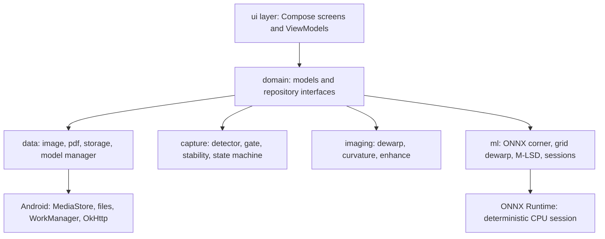
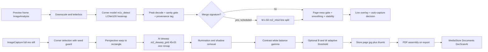
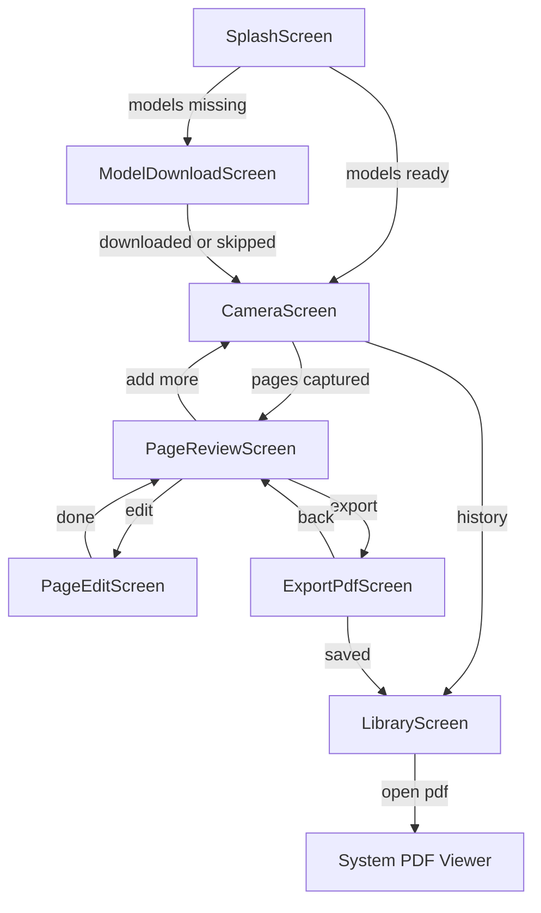
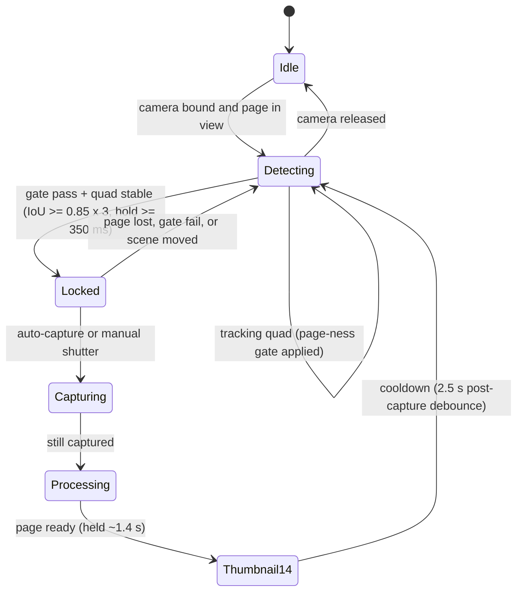
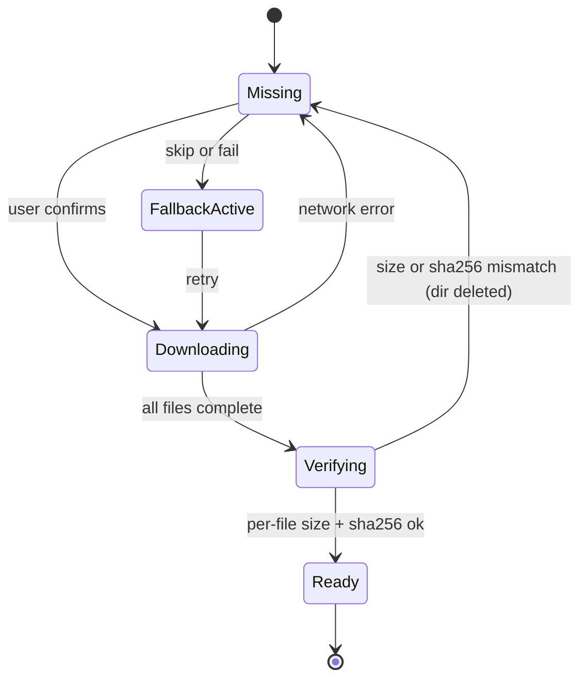

# DocScan AI — Architecture

> Companion to [`TECHNICAL_SPEC.md`](TECHNICAL_SPEC.md) and [`MODELS.md`](MODELS.md).
> Describes the module/package structure, the processing pipeline, screens/navigation, threading, and the locked dependency table.

---

## 1. Architectural style

- **Single Gradle module** (`:app`) with **internal packages** = low build risk, clear responsibilities.
- **Layered / unidirectional data flow:** `ui → domain ← data/ml`. UI observes immutable state; heavy work happens in `data`/`ml` behind suspend functions.
- **MVVM + Compose:** one `ViewModel` per screen; `StateFlow<UiState>` exposed to Composable screens.
- **Manual DI (ServiceLocator)** in `core/di` — no annotation processor (KSP/Hilt) ⇒ one fewer build-time toolchain to break. Swap to Hilt later only if needed.
- **Composition root:** [`DocScanApp`](app/src/main/java/com/docscanai/DocScanApp.kt) (Application) builds the ServiceLocator; [`MainActivity`](app/src/main/java/com/docscanai/MainActivity.kt) hosts the Compose `NavHost`.



> **Execution provider note.** All neural inference runs on the **CPU** EP in a **deterministic**
> session (SUBTASK H27) so identical input yields identical output. XNNPACK is opt-in behind a
> crash-safe fallback and is **off** for the dewarp graph; **NNAPI is deprecated** on Android 15 and
> is not used. This replaced the earlier "XNNPACK default / NNAPI opt-in" description.

---

## 2. Package responsibilities (locked)

| Package | Responsibility | Key types |
|---|---|---|
| `ui.*` | Compose screens, state, navigation | `AppNavHost`, `CameraScreen`, `PageReviewScreen`, `PageEditScreen`, `ExportPdfScreen`, `LibraryScreen`, `ModelDownloadScreen`, `SplashScreen` |
| `ui.screens.camera` | Capture UX + overlay | `CropOverlay`, `CaptureThumbnailStrip`, `CaptureViewModel` |
| `domain.model` | Pure data | `ScannedPage`, `ScanSession`, `Quad`, `PageEnhanceSettings`, `PageSize` |
| `domain.repository` | Interfaces | `ScanRepository`, `ModelRepository`, `ExportRepository` |
| `data.image` | CV pipeline | `BoundaryDetector`, `PerspectiveWarper`, `DewarpProcessor`, `Enhancer` |
| `data.pdf` | PDF build + publish | `PdfExporter`, `MediaStoreSaver` |
| `data.storage` | Session/files | `SessionStore`, `PageFileStore` |
| `data.model` | Model lifecycle | `ModelManager`, `ModelDownloader`, `ModelRegistry`, `ModelState` |
| `ml.*` | ORT wrappers | `OrtSessionFactory`, `BoundaryModel`, `DewarpModel`, `EnhanceModel` |
| `camera.*` | CameraX glue | `CameraController`, `FrameAnalyzer`, `CaptureStateMachine` |
| `core.*` | Cross-cutting | `ServiceLocator`, `BitmapUtils`, `Hashing`, `AppResult` |

---

## 3. End-to-end processing pipeline



**Stage ownership**

| Stage | Owner type | Thread | Notes |
|---|---|---|---|
| Preview analyze | `FrameAnalyzer` | dedicated single `Executor` | `KEEP_ONLY_LATEST`; drop frames under load |
| Corner inference | `OpenCvQuadPageDetector` (via `m1c_detect`) | analysis executor | 256² input; peak ≥ 0.3 or classical fallback |
| Merge repair | `MlsdTrigger` + `MlsdMergeRepair` (`m2_mlsd`) | analysis executor | **Scheduled**: signature + motion + 1-in-24 cadence; fold cached as geometry |
| Page gate + smoothing | `PagePlausibility` + `AutoCaptureStability` | analysis executor | fail-closed; guessed quads must prove a text block |
| Still capture | `CameraController` | CameraX | JPEG q95 |
| Corner selection | `OpenCvQuadPageDetector.refine()` (seed guard) | image queue | IoU ≥ 0.85 + area + containment, else keep seed |
| Dewarp | `NeuralGridDewarp` (`m2_dewarp_grid`) | image queue | 45×31 grid → one deterministic `remap` |
| Enhance | `ClassicalEnhancer` | image queue | classical CV (B&W uses Sauvola + light anti-alias) |
| Persist page | `PageFileStore` | image queue | app-private files |
| PDF build | `PdfExporter` | IO dispatcher | one page at a time, recycle bitmaps |
| Publish PDF | `MediaStoreSaver` | IO dispatcher | Documents → Downloads → DCIM → app dir |

---

## 4. Screens and navigation graph



**Routes (locked constants):** `splash`, `onboarding/download`, `camera`, `review`, `edit/{pageId}`, `export`, `library`.

**State ownership:** [`ScanSessionViewModel`](app/src/main/java/com/docscanai/ui/screens/review/ScanSessionViewModel.kt) is a **nav-graph-scoped** ViewModel holding `ScanSession` (ordered pages, per-page settings, enhancement mode) so it survives navigation and process death (mirrored to `SessionStore`).

---

## 5. Fast multi-page capture state machine



- **Auto-capture default ON.** A capture fires only when *all* of these hold (SUBTASK H21/H31):
  - the page-ness gate **passes** (`PagePlausibility`; a `CLASSICAL_FALLBACK`/`FULL_FRAME` quad must
    additionally prove a real multi-line text block),
  - the quad is **stable** across 3 frames with **IoU ≥ 0.85** (`AutoCaptureStability`),
  - the content has been still for a **≥ 350 ms minimum hold** on the frame clock,
  - the scene is **not in motion** (a content-MAD motion guard skips detection while moving),
  - the capture is **not a duplicate** (quad IoU ≥ 0.95 *and* content MAD ≤ 0.02 is suppressed),
  - the **2.5 s post-capture debounce** has elapsed.
- The **capture indicator** is `NONE` / `DOCUMENT_DETECTED` / `HOLD_STEADY`; the captured page stays
  visible ~1.4 s before the cooldown returns to detecting.
- **Manual shutter bypasses the gate and stability** and is never suppressed — the user is always
  in control.
- Capture appends to the session instantly; **processing is async** so the camera loop never blocks.

---

## 6. Threading & lifecycle

- **Main:** Compose + ViewModel state.
- **`frameExecutor`:** single thread for `ImageAnalysis` + boundary inference.
- **`imageQueue`:** single-threaded `CoroutineDispatcher` per session for capture→dewarp→enhance→persist (keeps page order, bounds memory to ~1 in-flight page).
- **`Dispatchers.IO`:** PDF build + MediaStore + downloads.
- **CameraX binding** to the Activity `LifecycleOwner`; unbind on `ON_STOP` to save battery; rebind on `ON_START`.
- **Process death:** `ScanSession` (files + order + settings) persisted ⇒ restore on relaunch.

---

## 7. CameraX configuration (locked)

| Use case | Config |
|---|---|
| `Preview` | `PreviewView`/Compose `AndroidView`, target rotation = display, `ResolutionSelector` preferring a 16:9 or 4:3 size ≈ screen |
| `ImageAnalysis` | `OUTPUT_IMAGE_FORMAT_RGBA_8888`, `STRATEGY_KEEP_ONLY_LATEST`, target ≈ 1280×720 (detection downscales further to 352) |
| `ImageCapture` | `CAPTURE_MODE_MAXIMIZE_QUALITY`, JPEG quality 95, flash AUTO, `setTargetRotation` |
| Extensions | optional `camera-extensions` (HDR/night) — off by default to keep the capture loop fast |

Analysis provides the **live quad**; `ImageCapture` provides the **full-res still** that is warped/dewarped/enhanced.

---

## 8. Data model (locked)

```text
ScanSession(id, createdAt, pages: List<ScannedPage>, enhanceMode)
ScannedPage(id, rawPath, processedPath, thumbPath, quad: Quad, rotation, enhancement, status)
Quad(topLeft, topRight, bottomRight, bottomLeft)   // in source-image coordinates
PageEnhanceSettings(mode: Original|Enhanced|Bw, gamma, contrast, shadowRemove, binarize)
PageSize(Auto|A4|Letter)
```

Files (app-private):
```
filesDir/scans/<sessionId>/raw/<pageId>.jpg
filesDir/scans/<sessionId>/page/<pageId>.jpg
filesDir/scans/<sessionId>/thumb/<pageId>.jpg
filesDir/models/<modelId>/model.onnx            (single-file model)
filesDir/models/<modelId>/<graph>.onnx[.data]   (multi-file model, e.g. m2_dewarp_grid)
filesDir/models/m2_mlsd/model.onnx              (tooling-provisioned, optional)
```

> The app-private scan root is **`scans`** (see `ScanPipeline.SCANS_DIR`), not `sessions`.

---

## 9. Model lifecycle (download → verify → ready → fallback)



- Managed by `ModelDownloadManager` / `ModelDownloadWorker` (a foreground **WorkManager** job that
  survives backgrounding), resumable via HTTP `Range` `.part` files.
- **Multi-file models** (SUBTASK H7, e.g. `m2_dewarp_grid`) download **per file** into the same model
  directory, each verified for **exact byte count + SHA-256**, promoted `.part` → final name, and the
  whole model directory is **deleted** on any mismatch.
- `ModelState` exposed as `StateFlow` to the download screen and to the pipeline (which picks the tier accordingly).
- **Never blocks the app:** `Missing`/`FallbackActive` ⇒ classical CV pipeline ([`MODELS.md`](MODELS.md) §3.4/§4.1).
- **`m2_mlsd` is not downloaded in-app** (no pin-able single-file URL); it is tooling-provisioned and
  the detector degrades to the 0.3.8 path when it is absent.

---

## 10. Locked dependency table

> Authoritative source is `gradle/libs.versions.toml`. Pinned for build reliability.

| Purpose | Coordinate | Version | License |
|---|---|---|---|
| Kotlin stdlib | `org.jetbrains.kotlin:kotlin-stdlib` | 2.0.21 | Apache-2.0 |
| Core KTX | `androidx.core:core-ktx` | 1.15.0 | Apache-2.0 |
| AppCompat | `androidx.appcompat:appcompat` | 1.7.0 | Apache-2.0 |
| Lifecycle | `androidx.lifecycle:lifecycle-runtime-ktx` / `-runtime-compose` / `-viewmodel-compose` | 2.8.7 | Apache-2.0 |
| Activity Compose | `androidx.activity:activity-compose` | 1.9.3 | Apache-2.0 |
| Compose BOM | `androidx.compose:compose-bom` | 2024.12.01 | Apache-2.0 |
| Compose UI / Material3 / icons | `androidx.compose.ui:ui`, `ui-graphics`, `ui-tooling-preview`, `androidx.compose.material3:material3`, `androidx.compose.material:material-icons-extended` | via BOM | Apache-2.0 |
| Navigation | `androidx.navigation:navigation-compose` | 2.8.5 | Apache-2.0 |
| CameraX | `androidx.camera:camera-core` / `-camera2` / `-lifecycle` / `-view` / `-extensions` | 1.4.1 | Apache-2.0 |
| ONNX Runtime Android | `com.microsoft.onnxruntime:onnxruntime-android` | 1.22.0 | MIT |
| OpenCV Android | `org.opencv:opencv` | 4.12.0 | Apache-2.0 |
| Coil Compose | `io.coil-kt:coil-compose` | 2.7.0 | Apache-2.0 |
| OkHttp | `com.squareup.okhttp3:okhttp` | 4.12.0 | Apache-2.0 |
| Coroutines | `org.jetbrains.kotlinx:kotlinx-coroutines-android` | 1.9.0 | Apache-2.0 |
| DataStore | `androidx.datastore:datastore-preferences` | 1.1.1 | Apache-2.0 |
| WorkManager | `androidx.work:work-runtime-ktx` | 2.10.0 | Apache-2.0 |
| Accompanist Permissions | `com.google.accompanist:accompanist-permissions` | 0.36.0 | Apache-2.0 |
| ExifInterface | `androidx.exifinterface:exifinterface` | 1.3.7 | Apache-2.0 |
| JUnit | `junit:junit` | 4.13.2 | EPL-1.0 |
| AndroidX Test | `androidx.test.ext:junit` / `androidx.test.espresso:espresso-core` | 1.2.1 / 3.6.1 | Apache-2.0 |
| Compose UI Test | `androidx.compose.ui:ui-test-junit4` | via BOM | Apache-2.0 |
| PDF | *platform* `android.graphics.pdf.PdfDocument` | SDK 35 | system |

**Plugins:** `com.android.application` 8.7.3, `org.jetbrains.kotlin.android` 2.0.21, `org.jetbrains.kotlin.plugin.compose` 2.0.21.

---

## 11. Gradle build blueprint (files the code subtask creates)

| File | Contents |
|---|---|
| `settings.gradle.kts` | `pluginManagement` + `dependencyResolutionManagement` (RepositoriesMode.FAIL_ON_PROJECT_REPOS, `google()`, `mavenCentral()`), `rootProject.name = "DocScanAI"`, `include(":app")` |
| `gradle/libs.versions.toml` | the version catalog from §10 |
| root `build.gradle.kts` | plugins declared `apply false` |
| `app/build.gradle.kts` | android block (compileSdk 35, minSdk 26, targetSdk 35, `jvmToolchain(17)`), `buildFeatures { compose = true }`, `packaging { resources excludes }`, `ndk { abiFilters += ["arm64-v8a"] }` (S25 FE is arm64-only; add `armeabi-v7a` if broader device support wanted), dependencies from catalog |
| `gradle.properties` | `org.gradle.jvmargs=-Xmx4g`, `android.useAndroidX=true`, `kotlin.code.style=official` |
| `proguard-rules.pro` | keep `ai.onnxruntime.**`, `org.opencv.**` (release minify) |

Recommended: **ABI split or `abiFilters` for `arm64-v8a`** to cut APK size (ONNX Runtime + OpenCV native libs are large).

---

## 12. Security & privacy

- **100% offline at runtime**; models cached locally; no telemetry.
- `INTERNET` used only during the first-launch model download over **HTTPS**.
- No `WRITE_EXTERNAL_STORAGE`; MediaStore scoped writes only.
- Only the final PDF is written to public storage; all intermediates stay app-private.

---

## 13. Build/run flow (Windows)

```bat
cd C:\Users\Kuzey\Desktop\DocScanAI
gradlew.bat :app:assembleDebug
gradlew.bat :app:installDebug
```
Or open the folder in Android Studio (Ladybug+) and Run. See the checklist in [`TECHNICAL_SPEC.md`](TECHNICAL_SPEC.md) §12.
