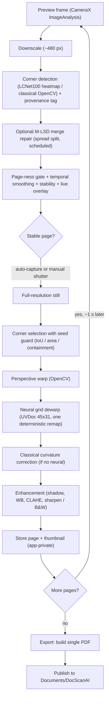

# DocScan AI

**DocScan AI** is a native Android document scanner that turns phone photos of pages into clean,
flattened, enhanced documents and exports them as a single PDF — **entirely on-device**.

It works like vFlat / Adobe Scan: point the camera at a page, and the app detects the four corners,
captures the page, flattens perspective and page curvature, cleans up the lighting, and lets you
scan the next page a second later. After the optional one-time AI-model download it is **fully
offline** — there is no cloud, no account, and no OCR.

- **Package / application ID:** `com.docscanai`
- **Language / UI:** Kotlin + Jetpack Compose (Material 3)
- **Version:** `19` / `0.3.16`
- **Target device:** Samsung Galaxy S25 FE (arm64-v8a), Android 14/15 — runs on Android 8.0 (API 26)+

> **Documentation map (start here).**
>
> | Document | What it covers |
> |---|---|
> | [`BUILD_AND_INSTALL.md`](BUILD_AND_INSTALL.md) | Build, sign, install, and **model provisioning** (in-app download *and* tooling push) |
> | [`ARCHITECTURE.md`](ARCHITECTURE.md) | Module/package layout, processing pipeline, threading, locked dependency table |
> | [`MODELS.md`](MODELS.md) | On-device model registry: I/O contracts, sizes, licences, fallbacks |
> | [`MODEL_SOURCES.md`](MODEL_SOURCES.md) | Where each pinned artifact comes from (URLs, SHA-256, attribution) |
> | [`TECHNICAL_SPEC.md`](TECHNICAL_SPEC.md) | Original design specification |
> | [`docs/RESULTS.md`](docs/RESULTS.md) | **Measured results and decisions per release** (H1–H31) + current product state |
> | [`docs/DETECTOR_STRATEGY.md`](docs/DETECTOR_STRATEGY.md) | What leading scanners do on-device and our detection approach |
> | [`docs/MODEL_STRATEGY.md`](docs/MODEL_STRATEGY.md) | Why this model stack (and the measured reasoning behind it) |
> | [`docs/HANDWRITING_ENHANCEMENT.md`](docs/HANDWRITING_ENHANCEMENT.md) | Pencil/faint-handwriting legibility research and its measured verdict |
> | [`docs/evidence/`](docs/evidence/) | **Visual evidence**: the AI corner heat maps + gate INK map per photo, and the quad-vs-ink measurement |
> | [`docs/runs/`](docs/runs/) | **Run records**: machine output of the measurement lanes (detector verdict over all 116 photos, ship provenance) |
>
> Everything below is maintained alongside the code. When a number here disagrees with
> [`docs/RESULTS.md`](docs/RESULTS.md), trust **RESULTS** and please fix the README.

---

## Table of contents

- [Features](#features)
- [How it works](#how-it-works)
- [The on-device AI models](#the-on-device-ai-models)
- [The classical fallback (no models needed)](#the-classical-fallback-no-models-needed)
- [Requirements](#requirements)
- [Quick start (build & run)](#quick-start-build--run)
- [Where your files are saved](#where-your-files-are-saved)
- [Permissions explained](#permissions-explained)
- [Project structure](#project-structure)
- [Screens & navigation](#screens--navigation)
- [Known limitations](#known-limitations)
- [Troubleshooting](#troubleshooting)

---

## Features

- **Fast continuous multi-page capture** — the vFlat-style loop: capture a page → a ~1 s
  confirmation thumbnail → immediately ready for the next page. No slow modal between pages.
- **Live 4-corner detection** — a document boundary is detected on the preview (~15–30 fps),
  smoothed over time, and drawn as an animated corner overlay so you can see exactly what will be
  captured.
- **Auto-capture or manual shutter** — auto-capture fires when a page has been held stable for a
  few frames (default **on**); you can also tap the big shutter button at any time.
- **Document flattening / dewarping** — full-resolution perspective correction, plus **neural
  dewarping (UVDoc)** when the optional model is available, and **classical curvature correction**
  as an always-available alternative.
- **Visual enhancement** — shadow / uneven-illumination removal, white balance, auto-levels, local
  contrast (CLAHE), and mild sharpening. Three modes: **Original**, **Enhanced** (default), and
  **B&W** (Sauvola binarization).
- **Page management** — review captured pages, rotate, reorder, delete, and re-crop/enhance.
- **Single-PDF export** — A4 / Letter / Fit page sizes, optional margins, and quality control,
  saved to the public **Documents** folder.
- **Library** — browse and reopen previously exported PDFs straight from the app.
- **Fully on-device** — no server calls at runtime; the only network use is the optional first-launch
  AI-model download.
- **No OCR** — DocScan AI is about *visual* document quality, not text extraction.

---

## How it works

There are two paths, both sharing the same building blocks: a **live preview path** (instant, runs
on every camera frame) and a **capture path** (higher quality, runs once per page).

### Live preview path

1. CameraX `ImageAnalysis` delivers frames (`RGBA_8888`, "keep only latest").
2. Each frame is downscaled to a small working size (~480 px long edge).
3. **Corner detection** (`OpenCvQuadPageDetector`): the **DocAligner LCNet100 corner model**
   (`m1c_detect`) predicts the four page corners directly as a heat map, with a robust **classical
   multi-cue OpenCV** path as the fallback. Every quad is tagged with its **provenance**
   (`CORNER_MODEL` / `CLASSICAL_FALLBACK` / `FULL_FRAME`).
4. **Merge repair (optional):** when the quad looks like a *two-page spread* (the failure where a
   facing page is wrongly included), the **M-LSD line model** (`m2_mlsd`) looks for a spine-parallel
   line crossing the quad and splits it. It is **scheduled**, not run on every frame (see
   [`ARCHITECTURE.md`](ARCHITECTURE.md) §3 and [`MODELS.md`](MODELS.md) §2.3).
5. **Page-ness gate** (`PagePlausibility`): coverage, aspect, a 55–125° angle rule, convexity, a
   paper score, and **text-line coherence**. A guessed (`CLASSICAL_FALLBACK` / `FULL_FRAME`) quad
   must additionally prove it holds a real multi-line text block before it is trusted for
   auto-capture — this is what stops the app "taking photos of random things in the room".
6. **Temporal smoothing + auto-capture stability** (`AutoCaptureStability`): the quad must hold
   steady (IoU ≥ 0.85 over 3 frames, a 350 ms minimum hold, a content-motion guard, and
   duplicate-capture suppression) before auto-capture fires. The result drives the **live 4-corner
   overlay**, the capture indicator, and the **auto-capture** decision.

### Capture path (per page)

1. **Full-resolution still capture** (CameraX `ImageCapture`, maximize quality, JPEG q95).
2. **Corner selection** on the full-resolution image, seeded by the live quad — protected by a
   **seed guard** so a bad refinement cannot replace a correct quad with an inner rectangle
   (IoU + area + containment checks; `refine()` keeps the seed when they fail).
3. **Perspective warp** (OpenCV) to an axis-aligned rectangle — the guaranteed baseline.
4. **Neural dewarp** (UVDoc grid `m2_dewarp_grid`) predicts a 45×31 sampling grid that is composed
   with the homography and applied to the original still in **one resampling pass** — a
   bit-deterministic session so identical input yields identical output. The image→image
   `m2_dewarp` model is the fallback.
5. **Classical curvature correction** to straighten curled text baselines *when no neural model
   produced a result* (a safe no-op when it is not confident).
6. **Enhancement** — shadow/illumination removal, white balance, auto-levels, CLAHE, sharpen; or
   Sauvola binarization in B&W mode (with a light anti-alias so strokes are not over-sharpened).
7. **Store** the raw capture, the processed page, and a thumbnail in app-private storage, and
   append the page to the session.

### Export

The ordered page images are rendered into a single multi-page PDF using the platform
`android.graphics.pdf.PdfDocument` (no third-party PDF dependency) and published to public storage.

### Pipeline diagram



Every stage is defensive: if a processor fails or a model is missing, the pipeline logs the issue
and falls back to the previous stage's result, so a capture never crashes the app.

---

## The on-device AI models

DocScan AI downloads **the pinned models on first launch** (or you can skip and use the classical
pipeline). They are used for the best automatic detection and flattening, and then the app runs
fully offline. Each is stored privately under `filesDir/models/<id>/`, downloaded resumably over
HTTPS (per file for multi-file models), and verified by **byte count + SHA-256** before use. The
exact pinned URLs and checksums live in
[`ModelRegistry.kt`](app/src/main/java/com/docscanai/models/ModelRegistry.kt) and are documented in
[`MODEL_SOURCES.md`](MODEL_SOURCES.md).

| Purpose (UI label) | Role | Model | Size | License | Status |
|---|---|---|---|---|---|
| **Page detector** (`m1c_detect`) | 4-corner detection | **DocAligner LCNet100** corner heat map | **4,767,987 B** (~4.5 MiB) | **Apache-2.0** | **Primary**, downloadable |
| **Page flattening** (`m2_dewarp_grid`) | Neural dewarp / flatten | **UVDoc 45×31 grid** (graph + data sidecar) | **31,831,242 B** (~30.4 MiB) | **Apache-2.0** | **Primary**, downloadable (2 files) |
| Page flattening (fallback) (`m2_dewarp`) | Image→image dewarp | **UVDoc** | **31,684,150 B** | Apache-2.0 | Downloadable fallback |
| Boundary detector (`m1_boundary`) | Edge map (legacy) | **DexiNed** | **47,235,563 B** | **MIT** | Retained, **no longer used for detection** |
| Merge repair (`m2_mlsd`) | Line evidence for two-page spreads | **M-LSD 320** | **6,170,288 B** | **Apache-2.0** | **Optional**, tooling-provisioned (see below) |

**Pinned artifacts (verified):**

- `m1c_detect` — DocAligner LCNet100 corner detector (**primary**)
  - URL: `https://huggingface.co/7rplus/pagescan-weights/resolve/main/lcnet100_h_e_bifpn_256_fp32.onnx`
  - SHA-256: `f4117b786e3a18470f3865c93f3c2bd69d9b998edd60f385574a5c665e79594e`
  - Upstream: <https://github.com/DocsaidLab/DocAligner> (Apache-2.0)
- `m2_dewarp_grid` — UVDoc 45×31 grid (**primary**; two files in one directory)
  - Graph: `…/UVDoc_grid.onnx` — 242,890 B — SHA-256 `044b406398e8accf2b8c896043f22d318221e443bb095c55d184e97f3eb003f7`
  - Data: `…/UVDoc_grid.onnx.data` — 31,588,352 B — SHA-256 `3a58a04944e59578200d7b0ed02ccb3ade934e9d88efa21454fbb8b53fa40f02`
  - Source: `https://huggingface.co/fredcallagan/uvdoc-grid-onnx`
  - Paper: Verhoeven et al., *UVDoc: Neural Grid-based Document Unwarping*, SIGGRAPH Asia 2023
- `m2_dewarp` — UVDoc image→image (fallback)
  - URL: `https://huggingface.co/PaddlePaddle/UVDoc_onnx/resolve/main/inference.onnx`
  - SHA-256: `54cab30dc2cf347b4f3d6971c833b1c3d84f5ef17280f1f6d15796bff20e63d6`
- `m1_boundary` — DexiNed (retained, not consulted)
  - URL: `https://huggingface.co/opencv/edge_detection_dexined/resolve/main/edge_detection_dexined_2024sep.onnx`
  - SHA-256: `a50d01dc8481549c7dedb9eb3e0123b810a016520df75e4669a504609982cdd0`
  - Original network: <https://github.com/xavysp/DexiNed> (MIT, © 2019 Xavier Soria Poma)
- `m2_mlsd` — M-LSD 320 (optional)
  - SHA-256: `26c4d103cdc0e126af94b97ecd5b12ad85b1a7cc8179e6c94177ef603c419e2a`
  - Upstream: <https://github.com/naver-ai/M-LSD> (Apache-2.0, NAVER Corp.)

Inference runs via **ONNX Runtime for Android** on the **CPU** execution provider, in a
**deterministic session** (so the same input always produces the same output). Models are loaded
lazily, so the app starts instantly and only pays the cost when a model is actually used.

**About `m2_mlsd` (optional).** The M-LSD model is not in the in-app download list because upstream
ships it only inside a single `resources.tar.gz` with no single-file URL to pin and verify. It is
**provisioned by tooling** (`tooling/_provision_models.cmd`, or an `adb push`) into
`filesDir/models/m2_mlsd/model.onnx`. When it is absent the detector behaves exactly like 0.3.8 —
the feature is optional and degrades gracefully. **Open packaging item:** a hosted single-file
mirror is needed before this can be user-downloadable in the app.

> **Not available yet.** The higher-quality dewarp (`m2p_dewarp_plus`), the light DewarpNet fallback
> (`m2f_dewarp_fallback`), and the optional neural shadow-removal model (`m3_shadow`) have **no
> canonical, published ONNX artifact**, so their URLs/hashes are intentionally left un-pinned. The
> app shows them as *"Not available yet"* and uses the classical fallbacks instead — it never treats
> them as broken. See [`MODEL_SOURCES.md`](MODEL_SOURCES.md) §2.

---

## The classical fallback (no models needed)

**The app is fully usable even if you skip the model download.** Every AI stage has a classical
OpenCV equivalent that requires no model at all:

- **Boundary detection** — adaptive Canny **∪** Otsu-thresholded Sobel gradients → morphology →
  contours → `approxPolyDP` → scored convex quad.
- **Perspective + curvature correction** — homography warp (`getPerspectiveTransform` +
  `warpPerspective`) plus a quadratic text-baseline fit that straightens residual page curl.
- **Enhancement** — large-kernel background-divide shadow removal, gray-world white balance,
  percentile auto-levels, CLAHE, gamma, and unsharp masking; **Sauvola** binarization for B&W.

Skipping the download changes nothing about what you can do — you keep perspective correction,
curvature correction, and full enhancement. It only means automatic boundary detection and neural
flattening rely on the classical (rather than neural) paths. You can download the models later from
the same setup screen.

---

## Requirements

| Item | Requirement |
|---|---|
| OS to **build** | Windows (the wrapper is `gradlew.bat`), macOS, or Linux |
| **JDK** | **JDK 21** (recommended for building; the project pins it — see below). Target bytecode is JDK 17. |
| **Android Studio** | *Ladybug 2024.2.1* or newer (to build `compileSdk 35` reliably) — **or** use the command line |
| **Android SDK** | Platform **35** / Build-Tools for AGP 8.7.3 |
| **Device to run** | An **arm64-v8a** Android device, Android 8.0 (API 26)+ — e.g. Galaxy S25 FE |
| **Disk** | Enough space for the SDK, Gradle caches, and the models (the two primary models total ~36 MiB; the optional extras add more) |

**Toolchain versions (pinned in [`gradle/libs.versions.toml`](gradle/libs.versions.toml)):**
Kotlin `2.0.21`, Gradle `8.10.2`, Android Gradle Plugin `8.7.3`, **compileSdk/targetSdk `35`**,
**minSdk `26`**, JVM target `17`. The APK is restricted to the **`arm64-v8a`** ABI.

> **JDK note (important):** this project pins `org.gradle.java.home=C:/Program Files/Java/jdk-21` in
> [`gradle.properties`](gradle.properties) because the machine's default JDK was **25**, which
> Gradle 8.10.2 does **not** support. If your default JDK is already 17 or 21, you can remove that
> line; otherwise keep it (and make sure a JDK 21 actually exists at that path). See
> [Troubleshooting](#jdk-mismatch-error).

---

## Quick start (build & run)

The short version — full, copy-paste steps are in [`BUILD_AND_INSTALL.md`](BUILD_AND_INSTALL.md).

**Option A — Android Studio:** open the `DocScanAI` folder, let Gradle sync, select the `app` run
configuration, connect the phone (Developer Options + USB debugging on), and click **Run**.

**Option B — Command line (Windows `cmd.exe`):**

```bat
cd C:\Users\Kuzey\Desktop\DocScanAI
set "JAVA_HOME=C:\Program Files\Java\jdk-21"
gradlew.bat assembleDebug
gradlew.bat installDebug
```

The debug APK lands at `app\build\outputs\apk\debug\app-debug.apk` (≈ **137.7 MiB** / 144,388,249 B).
The signed release APK lands at `app\build\outputs\apk\release\app-release.apk` (≈ **119.7 MiB** /
125,545,230 B). The bulk is the ONNX Runtime and OpenCV native libraries.

On first launch the app shows a **Set up AI models** screen. Tap **Download AI models** to fetch the
pinned models (the **Page detector** `m1c_detect` ≈ 4.5 MiB and the **Page flattening**
`m2_dewarp_grid` ≈ 30.4 MiB — about 35 MiB total, plus the optional fallback models), **or** tap
**Skip — use built-in processing** to start scanning immediately with the classical pipeline. Either
way, scanning works right away.

---

## Where your files are saved

**Exported PDFs** go to the public **`Documents/DocScanAI`** folder, published through MediaStore so
you will see them in Samsung **My Files** and any file manager — and the app's **Library** screen
lists them. No storage permission is required on modern Android.

If `Documents` cannot be used, the app automatically falls back, in order:

1. `Documents/DocScanAI` *(primary, via MediaStore)*
2. `Downloads/DocScanAI` *(via MediaStore)*
3. `DCIM/DocScanAI` *(via MediaStore)*
4. App-specific external directory (`getExternalFilesDir`) — always writable; reachable via the
   **Open** / **Share** buttons (the app tells you when this last resort was used).

**Intermediate files** (the raw capture, the processed page, and thumbnails) are kept in
**app-private storage** under `filesDir/scans/<sessionId>/` — no permission needed, and they are
cleaned up when a session is exported or discarded. **Only the final PDF is published to public
storage.**

On Android 8.0–9 (API 26–28), where MediaStore's `RELATIVE_PATH` does not exist, the PDF is written
with a plain `File` to `Documents/DocScanAI/` and indexed with `MediaScanner`; this path needs the
legacy `WRITE_EXTERNAL_STORAGE` permission (see below).

---

## Permissions explained

Declared in [`AndroidManifest.xml`](app/src/main/AndroidManifest.xml):

| Permission | Why | Notes |
|---|---|---|
| `CAMERA` | Scanning | **Runtime** request on the camera screen; required. |
| `INTERNET` | **One-time** model download | Not used at runtime once models are cached. |
| `ACCESS_NETWORK_STATE` | Detect connectivity for the download | Powers the "You're offline" message. |
| `POST_NOTIFICATIONS` | Download-progress notifications (API 33+) | Optional. |
| `WRITE_EXTERNAL_STORAGE` | Legacy PDF write on API 26–28 | Capped at `maxSdkVersion="28"` — **never requested on modern Android**. |

- The camera is declared as a **required** hardware feature.
- `usesCleartextTraffic` is **false** — model downloads must be HTTPS.
- No `WRITE_EXTERNAL_STORAGE` is needed on Android 10+ (scoped storage / MediaStore).
- A `FileProvider` is declared so the exported PDF can be opened/shared via a `content://` URI
  without exposing files.

---

## Project structure

Single Gradle module (`:app`) with internal packages for clarity and the lowest possible build risk.

```
DocScanAI/
├─ settings.gradle.kts              # module + repositories
├─ build.gradle.kts                 # root (plugins apply false)
├─ gradle.properties                # JVM args, JDK pin (org.gradle.java.home)
├─ local.properties                 # sdk.dir (local machine; git-ignored)
├─ gradlew / gradlew.bat            # Gradle wrapper (Gradle 8.10.2)
├─ README.md  BUILD_AND_INSTALL.md  # this doc + the build guide
├─ TECHNICAL_SPEC.md  ARCHITECTURE.md  MODELS.md  MODEL_SOURCES.md
├─ gradle/
│  ├─ libs.versions.toml            # single source of version truth
│  └─ wrapper/gradle-wrapper.properties
└─ app/
   ├─ build.gradle.kts              # SDK levels, ABI filter, dependencies
   ├─ proguard-rules.pro            # R8 keeps (ONNX, OpenCV, WorkManager)
   └─ src/main/
      ├─ AndroidManifest.xml        # permissions, FileProvider
      ├─ res/                        # strings, themes, colors, icons, xml/file_paths.xml
      └─ java/com/docscanai/
         ├─ DocScanApplication.kt    # Application: DI bootstrap + OpenCV load
         ├─ MainActivity.kt          # single Activity, Compose host
         ├─ core/
         │  ├─ di/ServiceLocator.kt  # manual DI container
         │  └─ util/                 # BitmapUtils, Hashing
         ├─ data/                    # SessionModels, repositories, SessionStore,
         │                           # SettingsRepository
         ├─ capture/                 # CameraController, CaptureStateMachine,
         │                           # FrameAnalyzer, OpenCvQuadPageDetector,
         │                           # PageDetector, ScanPipeline
         ├─ imaging/                 # PerspectiveDewarpProcessor, NeuralGridDewarp,
         │                           # ClassicalCurvatureCorrector, ClassicalEnhancer,
         │                           # DewarpProcessor, Enhancer
         ├─ ml/                      # OrtSessionFactory, OnnxModel
         ├─ models/                  # ModelRegistry, ModelDownloadManager,
         │                           # ModelDownloadWorker
         ├─ pdf/                     # PdfExporter, AndroidPdfExporter
         └─ ui/
            ├─ navigation/          # AppNavHost, Routes
            ├─ components/          # PdfIntents, reusable Composables
            ├─ session/             # ScanSessionViewModel (shared session state)
            ├─ theme/               # Material 3 theme
            └─ screens/
               ├─ splash/           # SplashScreen
               ├─ onboarding/       # ModelDownloadScreen
               ├─ camera/           # CameraScreen (+ live overlay, thumbnails)
               ├─ review/           # PageReviewScreen
               ├─ edit/             # PageEditScreen
               ├─ export/           # ExportPdfScreen
               └─ library/          # LibraryScreen
```

**Key concepts**

- **`ScanPipeline`** runs detect → dewarp → enhance → persist on a **single background thread** so
  pages are processed in order and the camera loop stays responsive.
- **`ScanSessionViewModel`** owns the active session (ordered pages + mode), shared across the
  Camera/Review/Edit/Export screens, and persisted so it survives rotation and process death.
- **`ServiceLocator`** is a tiny manual DI container (no annotation processors) that also owns the
  process-wide OpenCV and ONNX Runtime initialisation — both **best-effort**, so native failures
  degrade to the classical path instead of crashing.

---

## Screens & navigation

| Screen | What it does |
|---|---|
| **Splash** | Branded bootstrap; routes to setup (first run) or the camera. |
| **Set up AI models** (onboarding) | Optional download of the pinned models (`m1c_detect`, `m2_dewarp_grid`, `m2_dewarp`, `m1_boundary`) with live progress, **Retry**, and **Skip — use built-in processing**. The Quality-tier models are shown as *not available yet*. |
| **Camera** | The core: full-screen preview, live 4-corner overlay, big shutter, auto-capture toggle, torch, enhancement-mode chip, page counter, thumbnail strip, and the rapid ~1 s confirmation thumbnail. |
| **Review** | Page list with per-page thumbnails; rotate, move up/down, delete, open **Edit**; session-wide enhancement selector; **Add pages** and **Export PDF**. |
| **Edit page** | Before/after preview, rotate left/right, change enhancement mode (re-runs the pipeline), delete. |
| **Export PDF** | File name, page size (**A4 / Letter / Fit**), margins, quality; builds the PDF and shows **Open** / **Share** plus success/error cards. |
| **Library** | Lists previously exported PDFs (queried from MediaStore); tap to open, or delete. |

**Navigation:** `splash → onboarding/download → camera → review → edit/{pageId}` and
`camera → library`, `review → export`, `export → library` (see
[`AppNavHost.kt`](app/src/main/java/com/docscanai/ui/navigation/AppNavHost.kt) and
[`Routes.kt`](app/src/main/java/com/docscanai/ui/navigation/Routes.kt)).

---

## Known limitations

- **`m2p_dewarp_plus`, `m2f_dewarp_fallback`, and `m3_shadow` are intentionally un-pinned** ("not
  available yet"). The app uses the classical fallbacks for those roles. Only `m1_boundary`
  (DexiNed) and `m2_dewarp` (UVDoc) are real, pinned, downloadable artifacts.
- **Manual corner-drag re-crop on the Edit screen is a TODO.** The auto-detected corners are
  preserved and re-used when re-enhancing, but there is no interactive corner editor yet.
- **Page reordering uses Up/Down buttons** (not drag-and-drop) on the Review screen.
- **Offline first run means fallback mode.** If you skip (or cannot download) the models on first
  launch, detection and flattening run with the classical pipeline. Download the models later to
  enable the neural paths.
- **arm64-v8a + x86_64.** The APK ships `arm64-v8a` (the Galaxy S25 FE) and `x86_64` (for emulator
  testing). It will not install on 32-bit-only devices; add other ABIs in
  [`app/build.gradle.kts`](app/build.gradle.kts) if you need broader device support.
- **No OCR**, by design — this is a visual scanner, not a text extractor.
- **Portrait only** (the camera activity is locked to portrait for simplicity).

---

## Troubleshooting

### JDK mismatch error

**Symptom:** Gradle fails with a message like *"Unsupported class file major version"*, or
*"Android Gradle plugin requires Java …"*, or Gradle refuses to start.

**Cause:** the machine's default JDK is **25**, which **Gradle 8.10.2 does not support**. The
project pins **JDK 21** in [`gradle.properties`](gradle.properties) via
`org.gradle.java.home=C:/Program Files/Java/jdk-21`.

**Fix:**

1. Confirm a JDK 21 is installed at `C:\Program Files\Java\jdk-21`. If yours is elsewhere, update the
   `org.gradle.java.home` path in [`gradle.properties`](gradle.properties).
2. When building from the command line, also point `JAVA_HOME` at JDK 21 for the wrapper:

   ```bat
   set "JAVA_HOME=C:\Program Files\Java\jdk-21"
   gradlew.bat assembleDebug
   ```

3. If your default JDK is already 17 or 21, you can delete the `org.gradle.java.home` line entirely.

> Building with **Android Studio** uses the IDE's bundled JBR (JDK 17/21), so the pin is usually
> harmless there — but if Studio reports a JDK error, set *Settings → Build, Execution, Deployment →
> Build Tools → Gradle → Gradle JDK* to a JDK 17/21.

### No models / offline

**Symptom:** the setup screen says *"You're offline"*, a download fails with an error and a
**Retry** button, or you tapped **Skip**.

**What happens:** the app keeps working — it uses the **classical fallback** pipeline and shows a
non-blocking reminder. Nothing is locked or broken.

**Fix:** connect to the internet and re-open the setup/download screen (or tap **Retry**) to fetch
`Page detector` (`m1c_detect`, DocAligner LCNet100) and `Page flattening` (`m2_dewarp_grid`, UVDoc
grid). Downloads are resumable, so an interrupted download continues where it left off. If a
download reports a **SHA-256 mismatch**, the artifact was
deleted automatically and will be retried.

### Camera permission

**Symptom:** the camera screen shows *"Camera permission required"*.

**Fix:** tap **Grant camera access** and allow the permission. If it was permanently denied, tap
**Open app settings** and enable **Camera** for DocScan AI. The camera is the core feature, so the
app cannot scan without it.

### PDF not visible in the file manager

**Symptom:** the export succeeded but you can't find the PDF.

**Fix / checks:**

1. In Samsung **My Files**, look in **Documents → DocScanAI**, or open the app's **Library** screen
   and tap the file to open it.
2. If the app fell back, the PDF may be in **Downloads/DocScanAI** or **DCIM/DocScanAI**.
3. If the success card says **"app-private storage"**, the system refused the public folders; the
   file is only reachable via the **Open** / **Share** buttons on that card. Use **Share** to save
   or send it somewhere you can see it.
4. On Android 8.0–9, the legacy `Documents` write needs storage permission; if it was denied, the
   app falls back to the app-specific directory.

### Storage fallbacks

The app writes PDFs to `Documents/DocScanAI` first and silently falls back to `Downloads/DocScanAI`
→ `DCIM/DocScanAI` → the app-specific directory if a target cannot be created or written. The export
screen always shows the actual saved path, and the Library scans all of these locations, so the file
stays reachable even when the primary location is unavailable (e.g. unusual OEM storage settings).

### Build outputs are large

The debug APK is ≈ **137.7 MiB** (144,388,249 B) and the signed release APK ≈ **119.7 MiB**
(125,545,230 B). The bulk is the ONNX Runtime and OpenCV native libraries. The APK is limited to the
`arm64-v8a` + `x86_64` ABIs to keep it as small as possible; the release build additionally enables
R8 minification and resource shrinking.
