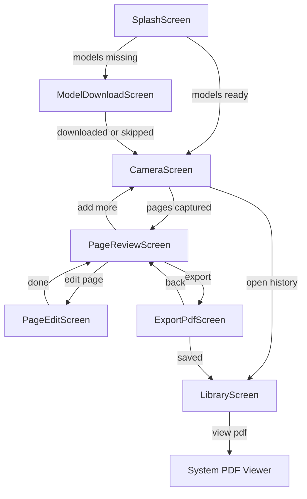
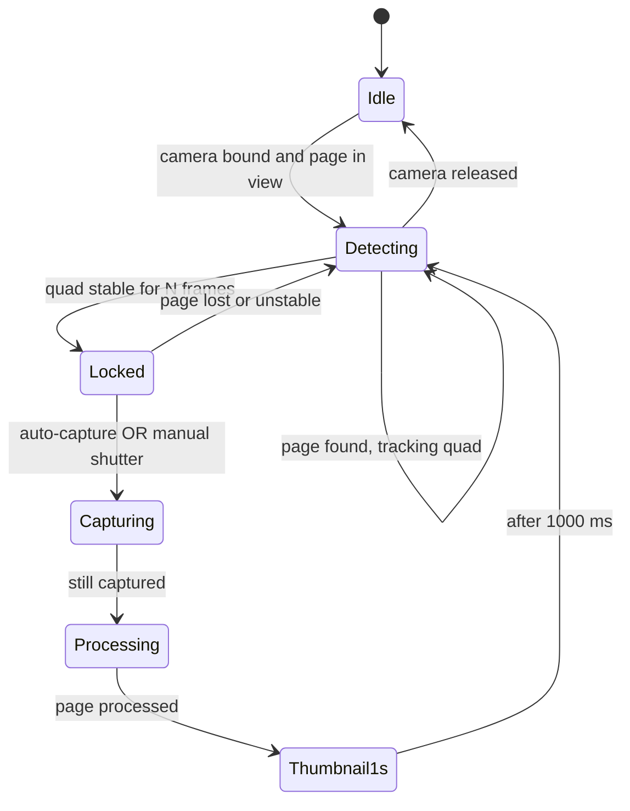

# DocScan AI — Locked Technical Specification

> Status: **LOCKED** (v1.0). This document is the source of truth for downstream coding subtasks.
> Companion documents: [`MODELS.md`](MODELS.md), [`ARCHITECTURE.md`](ARCHITECTURE.md).

---

## 1. Executive summary

**DocScan AI** is a native Android document-scanner in the style of vFlat/Adobe Scan:

- Fast **continuous multi-page camera capture** (capture → ~1 s thumbnail → instantly ready for next page).
- Robust **document boundary / 4-corner detection** on the live preview and on the full-resolution still.
- **All AI runs fully on-device** (ONNX Runtime; no cloud, no runtime internet except a one-time first-launch model download).
- **AI dewarp / flat-page rectification** (curvature correction) using a strong-but-practical neural model.
- **Visual enhancement** (illumination/shadow removal, contrast, white-balance, optional clean-up/binarization). **No OCR** — visual quality only.
- **Export to a single PDF** saved to the public **`Documents`** collection via MediaStore.
- Simple, modern, easy-to-use UI.

Target device: **Samsung Galaxy S25 FE** (Android 14/15, One UI, modern SoC, ample RAM).
Deliverable: a **Gradle + Kotlin** Android project (`DocScanAI/`) that the user builds in Android Studio or via `gradlew.bat`.

### 1.1 Definitions / non-goals
- **Non-goal:** OCR, text recognition, translation, cloud sync, accounts, ads, multi-user.
- **Non-goal:** iOS, desktop, or web.
- **Non-goal:** real-time *dewarping* of the preview (dewarping happens on the captured still, not the 30 fps preview).

---

## 2. Locked technology stack

### 2.1 Language, build, and toolchain

| Item | Decision | Rationale |
|---|---|---|
| Language | **Kotlin** (JVM target 17, `jvmToolchain(17)`) | Required by AGP 8.x + modern AndroidX. |
| Build files | **Gradle Kotlin DSL** (`.gradle.kts`) + **Version Catalog** (`gradle/libs.versions.toml`) | Single place for versions; Kotlin DSL is the Android Studio default; catalog prevents version drift. |
| Gradle wrapper | **Gradle 8.10.2** | Compatible with AGP 8.7.x; stable. |
| Android Gradle Plugin | **AGP 8.7.3** | Stable, supports `compileSdk 35`; works with Gradle 8.10.2. |
| Kotlin | **2.0.21** | Kotlin 2.0 ships the **Compose Compiler Gradle plugin** ⇒ no separate compose-compiler version to match (removes the #1 Compose build failure). |
| Java/JDK | **JDK 17** (bundled with Android Studio Ladybug+) | Required by AGP 8.x. |
| Android Studio | **Ladybug 2024.2.1 or newer** | Needed to build `compileSdk 35` reliably. |

### 2.2 SDK levels

| Level | Value | Rationale |
|---|---|---|
| `compileSdk` | **35** | Android 15 APIs available; matches AGP 8.7. |
| `targetSdk` | **35** | Correct modern behavior; target device is Android 14/15. |
| `minSdk` | **26** | ONNX Runtime AAR requires ≥ 24; 26 keeps OCR-free storage branches simple and still covers the vast majority of devices. CameraX supports ≥ 21. |

> **Storage note:** `MediaStore` `RELATIVE_PATH` (public `Documents`) requires API 29+. With `minSdk 26` the code MUST keep a small `if (SDK_INT >= Q)` branch and a legacy `File`/`MediaScanner` fallback for API 26–28. See §8.

### 2.3 UI toolkit decision — **Jetpack Compose** (locked)

**Decision: Jetpack Compose** (Material 3), *not* the classic View system.

Justification for build reliability **in this environment**:
1. With **Kotlin 2.0.21**, the Compose compiler is applied via the `org.jetbrains.kotlin.plugin.compose` plugin, whose version is tied to the Kotlin version. This eliminates the classic "compose compiler ↔ Kotlin mismatch" build failure entirely.
2. Versions are pinned via the **Compose BOM**, so all `androidx.compose.*` artifacts stay mutually consistent.
3. The live **4-corner detection overlay** and page-edit cropping UI are trivial with Compose `Canvas` (no custom `View` subclassing / XML).
4. It is the Android Studio default for new projects → best toolchain support.

**Mandated fallback (only if the environment's Android Studio is older than Ladybug):** downgrade the whole matrix together — Kotlin 1.9.24 + Compose Compiler 1.5.14 + Compose BOM 2024.05.00 + AGP 8.5.2 + Gradle 8.7. Do **not** mix matrices. The View system is *not* the planned fallback; a consistent older Compose matrix is preferred.

### 2.4 Application identity

| Item | Value |
|---|---|
| `applicationId` / `namespace` | **`com.docscanai`** (kept — two-segment package is valid and clean) |
| Display name | **DocScan AI** |
| `versionCode` / `versionName` | `1` / `0.1.0` |

### 2.5 Full dependency list (Version Catalog is authoritative)

> All versions are **pinned**. `onnxruntime-android`, `opencv`, and Compose artifacts are the only ones where a newer patch may be acceptable; bump only as a group and re-verify.

| Purpose | Coordinate | Version |
|---|---|---|
| Core KTX | `androidx.core:core-ktx` | 1.15.0 |
| AppCompat (theme/host) | `androidx.appcompat:appcompat` | 1.7.0 |
| Lifecycle runtime + viewmodel (Compose) | `androidx.lifecycle:lifecycle-runtime-ktx`, `lifecycle-runtime-compose`, `lifecycle-viewmodel-compose` | 2.8.7 |
| Activity Compose | `androidx.activity:activity-compose` | 1.9.3 |
| Compose BOM | `androidx.compose:compose-bom` | 2024.12.01 |
| Compose UI / Material3 / tooling | `androidx.compose.ui:ui`, `ui-graphics`, `ui-tooling-preview`, `androidx.compose.material3:material3`, `androidx.compose.material:material-icons-extended` | via BOM |
| Compose debug tooling | `androidx.compose.ui:ui-tooling` (debug) | via BOM |
| Navigation Compose | `androidx.navigation:navigation-compose` | 2.8.5 |
| CameraX | `androidx.camera:camera-core`, `camera-camera2`, `camera-lifecycle`, `camera-view`, `camera-extensions` | 1.4.1 |
| ONNX Runtime (Android) | `com.microsoft.onnxruntime:onnxruntime-android` | 1.20.0 |
| OpenCV (Android, Maven Central) | `org.opencv:opencv` | 4.10.0 |
| Coil (Compose image loading) | `io.coil-kt:coil-compose` | 2.7.0 |
| HTTP client (model download) | `com.squareup.okhttp3:okhttp` | 4.12.0 |
| Coroutines | `org.jetbrains.kotlinx:kotlinx-coroutines-android` | 1.9.0 |
| DataStore (prefs / model state) | `androidx.datastore:datastore-preferences` | 1.1.1 |
| WorkManager (resumable download) | `androidx.work:work-runtime-ktx` | 2.10.0 |
| Permissions | `com.google.accompanist:accompanist-permissions` | 0.36.0 |
| Exif | `androidx.exifinterface:exifinterface` | 1.3.7 |
| Unit test | `junit:junit` | 4.13.2 |
| Android test | `androidx.test.ext:junit`, `androidx.test.espresso:espresso-core` | 1.2.1 / 3.6.1 |
| Android test (Compose) | `androidx.compose.ui:ui-test-junit4` (debug) | via BOM |

**PDF generation:** use the platform **`android.graphics.pdf.PdfDocument`** — no third-party dependency (reliable, offline, no native lib). See §9.

---

## 3. Project structure (single-module, locked)

Single Gradle module **`:app`** is deliberately chosen for build reliability (no multi-module graph to misconfigure). Internal *package* structure provides the modularity.

```
DocScanAI/
├─ settings.gradle.kts
├─ build.gradle.kts                      (root, plugins declared apply false)
├─ gradle.properties
├─ gradle/
│  ├─ libs.versions.toml                 (single source of version truth)
│  └─ wrapper/gradle-wrapper.properties  (Gradle 8.10.2)
├─ gradlew / gradlew.bat
└─ app/
   ├─ build.gradle.kts
   ├─ proguard-rules.pro
   └─ src/main/
      ├─ AndroidManifest.xml
      ├─ res/                            (themes, icons, strings, xml/file_paths.xml)
      └─ java/com/docscanai/
         ├─ DocScanApp.kt                (Application: DI entry, model bootstrap)
         ├─ MainActivity.kt              (single Activity, Compose host)
         ├─ core/
         │  ├─ di/                       (manual DI container / ServiceLocator)
         │  ├─ util/                     (bitmap utils, hashing, logging)
         │  └─ result/                   (Result/AppResult types)
         ├─ domain/
         │  ├─ model/                    (ScannedPage, ScanSession, Quad, PageEnhanceSettings)
         │  └─ repository/               (interfaces)
         ├─ data/
         │  ├─ image/                    (WarpRepo, DewarpRepo, EnhanceRepo)
         │  ├─ pdf/                      (PdfExporter)
         │  ├─ storage/                  (MediaStoreSaver, SessionStore)
         │  └─ model/                    (ModelManager, ModelDownloader, ModelRegistry)
         ├─ ml/
         │  ├─ OrtSessionFactory.kt      (OrtEnvironment + SessionOptions, EP selection)
         │  ├─ boundary/BoundaryDetector.kt
         │  ├─ dewarp/DewarpModel.kt
         │  └─ enhance/EnhanceModel.kt   (optional neural shadow removal)
         ├─ camera/
         │  ├─ CameraController.kt       (CameraX bind/unbind, use-case factories)
         │  ├─ CaptureStateMachine.kt
         │  └─ FrameAnalyzer.kt          (ImageAnalysis → boundary detection)
         └─ ui/
            ├─ theme/
            ├─ nav/AppNavHost.kt, Routes.kt
            ├─ screens/
            │  ├─ onboarding/ (SplashScreen, ModelDownloadScreen)
            │  ├─ camera/     (CameraScreen, CropOverlay, CaptureThumbnailStrip)
            │  ├─ review/     (PageReviewScreen)
            │  ├─ edit/       (PageEditScreen)
            │  ├─ export/     (ExportPdfScreen)
            │  └─ library/    (LibraryScreen)
            └─ components/    (reusable Composables)
```

Detailed module/package responsibilities and diagrams: [`ARCHITECTURE.md`](ARCHITECTURE.md).

---

## 4. Image-processing pipeline (locked)

Two tiered paths share the same building blocks.

### 4.1 Live preview path (must feel instant; ≤ ~30 ms/frame budget)
1. **`ImageAnalysis`** (CameraX) delivers frames at ~15–30 fps, `STRATEGY_KEEP_ONLY_LATEST`, `RGBA_8888`/YUV → converted to bitmap.
2. **Downscale** to a fixed working width (e.g. **320 px** long edge) for detection.
3. **Boundary detection** (ONNX) → probability map / heatmap.
4. **Post-process**: threshold → largest connected component → contour → approximate to a **quad** (Douglas–Peucker + `minAreaRect` sanity check); reject degenerate/inverted quads.
5. **Temporal smoothing** (EMA over quads; if the quad is stable for N frames → "page locked"), then draw the **4-corner overlay** on the Compose `Canvas`.

### 4.2 Capture path (full quality; per page, target < 1.5 s)
1. **`ImageCapture`** takes a full-resolution still (JPEG, quality 95, or `CAPTURE_MODE_MAXIMIZE_QUALITY`).
2. Decode → **corner refinement** on full resolution, seeded by the live quad (re-run the detector at medium resolution + edge refinement on the 4 edges).
3. **Perspective warp** (OpenCV `warpPerspective` / `getPerspectiveTransform`) to an axis-aligned rectangle; choose output size from the quad's side lengths with an aspect-preserving cap (e.g. max 3000 px long edge).
4. **AI dewarp / flatten** (ONNX) → corrected flat page (`MODELS.md` model **M2**).
5. **Enhancement**:
   a. **Illumination / shadow removal** — divide by a large-kernel blurred background estimate + CLAHE.
   b. **White balance / auto-levels** (gray-world on the low-frequency component).
   c. **Contrast / gamma**.
   d. **Optional clean-up modes** (user toggle): *Original*, *Enhanced* (default), *Black & White* (local adaptive / Sauvola binarization).
   e. Optional neural shadow-removal model (M3) if enabled — off by default (classical is faster and sufficient).
6. Store the resulting page bitmap as a **JPEG/PNG** under app cache/files (see §8.3), plus a **thumbnail**.
7. Emit to the session → UI shows the ~1 s thumbnail and returns to live capture.

### 4.3 PDF assembly (on export)
1. Load each page image (in user order) at export resolution.
2. For each page: create a `PdfDocument.PageInfo` (A4 or "fit image", configurable) and draw the bitmap scaled to fit, or use the image's own size.
3. Write the single `PdfDocument` to a temp file, then publish it to MediaStore (§8.2).

### 4.4 Where each stage runs (threading)
- Frame analysis: **single dedicated `Executor`** (never the main thread); drop frames under load.
- Capture/dewarp/enhance: a **single-threaded queue per session** so pages process in order without starving the camera.
- ONNX sessions: created once (lazy, warm) and reused; **CPU/XNNPACK by default**, with NNAPI attempted only for supported models and with a CPU fallback (§5.4).

---

## 5. Model strategy (summary — full registry in [`MODELS.md`](MODELS.md))

### 5.1 The "up to 5 GB" trade-off (explicit decision)

The user asked for a *high-quality* dewarp model and said it could be "up to ~5 GB." **A 5 GB model is not practical on-device** and is explicitly **rejected** as the primary path, for concrete reasons:

- **RAM/latency:** a 5 GB model (likely hundreds of millions of params) will not load and infer within the ~1.5 s/page interactive budget on a phone; the app would OOM or take many seconds per page.
- **Accelerator support:** large transformer/CDM models usually do **not** partition well to NNAPI/GPU on Android via ONNX Runtime → CPU-only → unacceptable speed.
- **Distribution:** 5 GB first-launch download is hostile UX and heavy on device storage.
- **Diminishing returns:** modern **grid-based unwarping** models (tens of MB) already produce near-flat output on typical phone-captured documents.

**Recommendation (locked):** use the best *quality-per-practicality* models — small-to-medium neural models (tens of MB) that infer in well under a second — and expose a **"Quality" tier** the user can opt into (a larger dewarp model, still ≤ ~300 MB). Provide a **classical TPS fallback** so the app never fails.

### 5.2 Model tiers

| Tier | Detection | Dewarp | Enhancement | When |
|---|---|---|---|---|
| **Fast** (default) | DexiNed-based boundary (M1) | UVDoc grid unwarp (M2) | Classical OpenCV | Always-capable, default |
| **Quality** (opt-in) | M1 + full-res refine | Heavier unwarp (M2-Plus / DRCNet) | Classical + optional DocShadow (M3) | User enables in Settings |
| **Fallback** | Classical edges (Canny/Sobel + contours) | Classical TPS from estimated page curve | Classical OpenCV | Model missing / ORT fails |

### 5.3 Final recommended models (summary)

- **M1 — Boundary detection:** **DexiNed** (edge/boundary detector, ONNX). ~3.5 M params, **≈ 35 MB**, **MIT**. Outputs a 1-channel edge probability map at input resolution. Post-processed to a document quad. *Alternative:* a fine-tuned lightweight **U-Net/DeepLabV3 semantic segmentation** exported to ONNX (best if produced in a later subtask).
- **M2 — Dewarp/flatten (PRIMARY):** **UVDoc** (Universal Document Rectification, neural grid-based unwarping, SIGGRAPH Asia 2023). **MIT**. ~small-to-medium (**≈ 30–60 MB**, ONNX-convertible), outputs a **2D displacement grid** (e.g. `45×45×2`) used to resample the page flat. Strong on real phone photos.
  - **M2-Plus (Quality tier):** **DRCNet / PaperEdge** or **DocTr++** (larger, tens–hundreds of MB).
  - **M2-Fallback:** **DewarpNet WC** (~8 MB, MIT) or **classical TPS**.
- **M3 — Enhancement (optional, off by default):** **DocShadow** (document shadow removal) ONNX; otherwise **classical OpenCV** illumination normalization is the locked default.

Exact I/O shapes, preprocessing/postprocessing, licenses, and canonical source URLs are in [`MODELS.md`](MODELS.md).

### 5.4 Execution providers
Attempt order: **NNAPI** (if model ops are fully supported) → **XNNPACK/CPU** (always-safe default). Because NNAPI partitioning of non-CNN ops is unreliable, **the default locked provider is CPU with XNNPACK**, and NNAPI is an opt-in experimental path with automatic CPU fallback on any `OrtException`. Threads: `setIntraOpNumThreads` = 2–4; warm up each session once at startup.

---

## 6. Screens & navigation

### 6.1 Screens
1. **SplashScreen** — logo + app bootstrap; routes to onboarding or camera.
2. **ModelDownloadScreen** — first-launch model download with progress, resume, retry, skip-and-use-fallback.
3. **CameraScreen** — the core. Live preview, 4-corner overlay, shutter/auto-capture toggle, page counter, thumbnail strip (last N captures), torch, mode (Original/Enhanced/B&W).
4. **PageReviewScreen** — grid of captured pages; reorder (drag), rotate, delete, select all; "Add more" (back to camera); "Export".
5. **PageEditScreen** — single page: re-crop (adjust the 4 corners manually), re-run dewarp/enhance, choose enhancement mode, before/after slider, reset.
6. **ExportPdfScreen** — PDF options (page size: Auto/A4/Letter, quality, filename), then "Save"; shows saved path/success action (open PDF).
7. **LibraryScreen** — list previously exported PDFs (queried from MediaStore `Documents/DocScanAI`), tap to open.

### 6.2 Navigation graph



Routes (locked string constants in `Routes.kt`): `splash`, `onboarding/download`, `camera`, `review`, `edit/{pageId}`, `export`, `library`.

Session state (captured pages, order, settings) is held in **`ScanSessionViewModel`** and persisted to `SessionStore` (DataStore + files) so rotation/process-death doesn't lose captured pages.

### 6.3 Fast multi-page capture state machine



Rules:
- **Auto-capture** (default ON): fires when state = `Locked` (stable quad) and motion is low; cooldown so at most one capture per ~1.2 s.
- **Manual** mode: user presses shutter.
- During `Processing`, the next frames are still analyzed, but capture is blocked until `Detecting`.
- `Thumbnail1s` shows the freshly captured page ~**1000 ms**, then returns to `Detecting` (this is the vFlat-style rapid loop).
- Captures append to the session **immediately**; heavy processing runs on a background queue.

### 6.4 UX requirements
- Big, obvious shutter; large tap targets; dark camera UI.
- Thumbnail strip with count so the user sees progress.
- Haptics on capture; subtle shutter sound (respect system mute).
- Everything reachable one-handed; no nested deep menus.

---

## 7. Permissions & manifest

| Permission | Why | Notes |
|---|---|---|
| `android.permission.CAMERA` | Scanning | Runtime request via Accompanist; required. |
| `android.permission.INTERNET` | **One-time** model download | Not used at runtime otherwise. |
| `android.permission.ACCESS_NETWORK_STATE` | Detect connectivity for download | |
| `android.permission.POST_NOTIFICATIONS` | Download progress notification (API 33+) | Optional. |
| Storage | **No** `WRITE_EXTERNAL_STORAGE` needed | MediaStore `RELATIVE_PATH` on API 29+ needs no permission to write to `Documents`. |

Manifest essentials:
- `<uses-feature android:name="android.hardware.camera" android:required="true"/>`
- `android:requestLegacyExternalStorage` **not** used (targetSdk 35 is fully scoped-storage).
- `MainActivity` exported, launcher intent, `android:screenOrientation="portrait"` (locked for camera simplicity) — or handle rotation if desired later.
- Declare a `FileProvider` (`res/xml/file_paths.xml`) for sharing the generated PDF via "open in viewer".
- `android:usesCleartextTraffic="false"`; models must be downloaded over **HTTPS**.

---

## 8. File-save strategy (MediaStore)

### 8.1 Target location
**Primary:** public **`Documents/DocScanAI/`** collection:

```
RELATIVE_PATH = Environment.DIRECTORY_DOCUMENTS + "/DocScanAI"
```
Published via `ContentResolver.insert(MediaStore.Files.getContentUri(MediaStore.VOLUME_EXTERNAL_PRIMARY), values)` with:
- `DISPLAY_NAME = "DocScanAI_yyyyMMdd_HHmmss.pdf"`
- `MIME_TYPE = "application/pdf"`
- `RELATIVE_PATH = "Documents/DocScanAI"`
- `IS_PENDING = 1` while writing → set to `0` on success (atomic publish).

This matches mainstream scanner apps (Adobe Scan / vFlat-style) which land in the public **Documents** folder.

**Fallback order (if `Documents` insert fails):**
1. `Environment.DIRECTORY_DOWNLOADS + "/DocScanAI"` via MediaStore.
2. `Environment.DIRECTORY_DCIM + "/DocScanAI"` via MediaStore.
3. App-specific external files dir (`getExternalFilesDir(null)`) as last resort (always writable, no permission) notified to the user.

**API 26–28 branch:** `MediaStore` `RELATIVE_PATH` is unavailable; write with `File` + `Environment.getExternalStoragePublicDirectory(DIRECTORY_DOCUMENTS)` and trigger `MediaScannerConnection`. (Kept minimal; target device is API 34/35.)

### 8.2 PDF write flow
1. Generate PDF into `cacheDir` temp file via `PdfDocument`.
2. Insert MediaStore row (`IS_PENDING=1`) → `openOutputStream` → copy temp bytes → `IS_PENDING=0`.
3. On any failure, delete the pending row and fall back per §8.1.
4. Optionally expose "Open" (FileProvider `content://` share intent) and "Share".

### 8.3 Intermediate/captured images
- Store captured + processed page images in **app-private storage** (`context.filesDir/sessions/<sessionId>/`) — no permissions, cleared when a session is exported or discarded.
- Only the **final PDF** is published to the public `Documents` folder.
- Thumbnails in `cacheDir/sessions/<sessionId>/thumbs/`.

---

## 9. PDF generation details
- Use **`android.graphics.pdf.PdfDocument`** (platform API, no dependency).
- Page sizing options: **Auto** (page = image aspect), **A4**, **Letter**; fit with uniform scale + centered margins.
- Bitmap → page via `Canvas.drawBitmap(dstRect)`. Draw as JPEG-encoded bitmap; keep memory bounded (recycle after draw, process one page at a time).
- Multi-page: `startPage` / `finishPage` per page; `writeTo(OutputStream)` at the end.
- Metadata: set `PdfDocument` document info title = `"DocScan AI - <date>"`.

---

## 10. First-launch model download strategy (locked)

- **Where from:** HTTPS from a pinned model host (Hugging Face / GitHub Releases). Exact per-model URLs + SHA-256 in [`MODELS.md`](MODELS.md). The download subtask MUST record SHA-256 at fetch time and pin them in `ModelRegistry`.
- **Where stored:** `context.filesDir/models/<modelId>/<file>.onnx` (private; survives updates; not cleared by cache eviction).
- **Manager:** `ModelManager` + `ModelDownloader`
  - **OkHttp** with `Range` requests ⇒ **resumable** downloads (persist bytes-so-far + ETag in DataStore).
  - **Checksum verification** (SHA-256) after download; reject + retry on mismatch.
  - **Progress UI** in `ModelDownloadScreen` (per-model + overall %, MB/s, ETA) driven by a foreground **WorkManager** job so it survives backgrounding.
  - **Retry** with backoff; manual "Retry" button.
  - **Skip / offline fallback:** if download fails or user skips, app runs with the **Fallback tier** (classical CV + DewarpNet WC if present) and shows a non-blocking banner offering to retry later. The app **must never be unusable** due to a missing model.
  - **Integrity/space check:** verify free storage before download; warn if insufficient.
- **Bootstrap order:** Splash → check `ModelRegistry` state → if Fast tier present, go to Camera; else `ModelDownloadScreen`.
- **No runtime internet:** after models are cached, disable all networking; the app fully works offline.

---

## 11. Risks, unknowns, and mitigations

| # | Risk | Severity | Mitigation |
|---|---|---|---|
| R1 | **Dewarp model quality** varies by page/lighting; "5 GB = good" expectation unmet | High | Tiered models (Fast/Quality) + classical TPS fallback + per-page manual corner adjust; document the trade-off explicitly (this doc, §5.1). |
| R2 | Detection model (**DexiNed**) may be edgy on low-contrast pages | Medium | Temporal smoothing + full-res refine + classical Canny fallback + manual crop. |
| R3 | **NNAPI** partitioning failures for some ops | Medium | Default to XNNPACK/CPU; NNAPI opt-in with automatic fallback. |
| R4 | **Large model download** UX / storage | Medium | Resumable download, skip option, Fast tier default, storage pre-check. |
| R5 | Model **URLs/licenses change** upstream | Medium | Pin commit/release tags + SHA-256 in `ModelRegistry`; host known-good copies if license permits. |
| R6 | Compose/AGP/Kotlin **version mismatch** on older Android Studio | Medium | Single pinned matrix + documented fallback matrix (§2.3); Version Catalog. |
| R7 | **MediaStore** variance across OEMs (Samsung One UI) | Low/Med | Fallback chain Documents→Downloads→DCIM→app dir; test on S25 FE. |
| R8 | **Latency** of dewarp on full-res images | Medium | Downscale input to model's trained resolution; process one page at a time on a background thread; cap output ≤ 3000 px. |
| R9 | **Memory** (bitmaps + ORT + OpenCV) | Medium | Recycle bitmaps, reuse ORT tensors, `largeHeap` only if proven necessary (prefer not). |
| R10 | ONNX conversion of the dewarp model (PyTorch→ONNX) fidelity | Medium | Conversion is a **separate prep task**; validate numerics vs reference; keep DewarpNet/classical fallback. |
| R11 | Downstream subtask might not find exact model files | Medium | `MODELS.md` lists canonical repos + expected filenames; download task must pin final URLs+hashes. |

---

## 12. Build-verification checklist

- [ ] `gradlew.bat --version` shows Gradle 8.10.2 and JDK 17.
- [ ] `gradlew.bat :app:assembleDebug` succeeds with no version-conflict warnings.
- [ ] App installs and launches on the S25 FE (or emulator API 34/35).
- [ ] Camera permission + preview works; overlay renders.
- [ ] Multi-page capture loop: capture → ~1 s thumbnail → ready, repeatedly.
- [ ] With **no models present**: app runs in Fallback tier and shows the download banner.
- [ ] Model download resumes after being killed mid-download; SHA-256 verified.
- [ ] Captured page → dewarp → enhance produces a visually flat, clean page.
- [ ] Export produces a single valid multi-page PDF.
- [ ] PDF appears in **`Documents/DocScanAI/`** in the Samsung "My Files" app; opens in a PDF viewer.
- [ ] Airplane mode after models are cached: full offline functionality.
- [ ] No `INTERNET` calls at runtime (verify via a network-stripped test).

---

## 13. Open questions for the user (non-blocking)
1. Page-size default for export: **Auto** (matches image) vs **A4**? (Spec defaults to **Auto**.)
2. Auto-capture default **ON** vs manual-only? (Spec defaults to **ON**.)
3. Acceptable download size budget for the default tier (spec assumes **≤ ~100 MB** default, opt-in Quality up to **~300 MB**).
4. Locked portrait orientation OK? (Spec assumes **yes**.)
