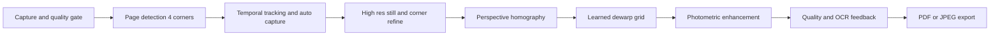

# DocScan AI — Model Strategy and Document-Scan Pipeline Research

**Subtask:** H6 — research only. No app source, Gradle, model registry, or tooling was modified; no Gradle build and no emulator run was performed. No pinned model URL or SHA-256 was changed.

**Date:** 2026-10-17
**Target device:** Samsung Galaxy S25 FE — Exynos 2400, 8 GB RAM, 4,900 mAh, Android 15 / One UI 8 class ([Samsung official specifications](https://www.samsung.com/uk/smartphones/galaxy-s/galaxy-s25-fe-navy-128gb-sm-s731bdbdeub), [Samsung newsroom](https://news.samsung.com/global/meet-samsung-galaxy-s25-fe-the-gateway-to-the-galaxy-ai-and-flagship-essentials)).
**Current runtime:** ONNX Runtime Android 1.22.0, CPU EP default, XNNPACK opt-in, NNAPI off; OpenCV Android 4.12.0.

**Evidence labels used throughout**

| Label | Meaning |
|---|---|
| **VERIFIED** | Stated in an official document, paper, model card, repository, or measured directly in this project. |
| **REPORTED** | Stated by a credible secondary source or a vendor claim that could not be independently reproduced here. |
| **INFERRED** | Engineering inference from the above; not directly stated by a primary source. |
| **NOT PUBLISHED** | The number or detail does not exist in public sources. |

---

## 0. Bottom line first

Our model stack is **not under-sized for the Galaxy S25 FE**. It is **mis-deployed**.

- Detection: LCNet100 is a 1.2 M-parameter, 4.9 MB, 1.6 GFLOPs corner heat-map model at 256×256. It scored **0.9892 Jaccard on SmartDoc 2015**, within **0.45 percentage points** of the 20.8 M-parameter, 83.1 MB FastViT-SA24 ([DocAligner benchmark](https://docsaid.org/en/docs/docaligner/benchmark)). The detection side is correctly sized.
- Dewarp: UVDoc is an **8 M-parameter** model, competitive with DocTr/DocTr++/DocScanner on DocUNet and behind the 2024 DocRes generalist ([UVDoc paper](https://arxiv.org/abs/2302.02887), [DocRes paper](https://arxiv.org/abs/2405.04408)). The model capacity is mid-range and appropriate.
- The real problem is that our pinned export is **image→image at a 2048 px long edge**. That runs the decoder at ~8.6× the reference 712×488 pixel count, forces a second resample, and synthesizes text instead of sampling the original page. Measured native heap peak is **638 MB**, and AI-ON sharpness is only **0.754×** the classical path.
- The fix is not a bigger model. It is a **grid-output UVDoc at 720×496 applied once to the original full-resolution page**, plus keeping LCNet100 detection and the existing homography. That preserves the original text pixels and cuts the dewarp pixel count by roughly an order of magnitude.

---

## 1. What is the standard architecture of a modern mobile document-capture-and-rectification pipeline?

A production mobile scanner is normally a **staged, fail-soft pipeline**, not one end-to-end network. The stages below are the common denominator across Google ML Kit Document Scanner, Adobe Scan, ABBYY Mobile Capture, Kofax Mobile SDK, and the open-source research pipelines.

| # | Stage | What it does | Output |
|---|---|---|---|
| 1 | **Capture and quality gate** | Camera preview, exposure/focus lock, blur and motion check, document-presence check, glare check. | A frame plus a quality decision. |
| 2 | **Page detection / localization** | Finds the page boundary as 4 corners, a heat-map, a mask, or a polygon. Common approaches: edge/contour classical CV, corner heat-map regression, segmentation, or a small object detector. | Page quad in frame pixel coordinates, or a page mask. |
| 3 | **Temporal tracking and auto-capture** | Smooths the quad across frames, checks stability, fill ratio, and corner confidence; triggers the shutter when the page is stable and fully visible. | A stable quad and an auto-capture decision. |
| 4 | **High-resolution still and corner refinement** | Captures the full-resolution still, then re-runs detection or corner refinement on the still or on a crop around the preview quad. | Refined quad at still resolution. |
| 5 | **Perspective rectification** | Estimates a 3×3 homography from the 4 corners and warps the page to a rectangle. This removes keystone/perspective for a planar page. | Fronto-parallel page bitmap. |
| 6 | **Dewarp / flatten** | Models non-planar deformation — page curl, book gutter, folds, wrinkled paper — with a dense flow, a coordinate grid, or a 3D shape model. | Flattened page, ideally by a single resample from the original still. |
| 7 | **Photometric enhancement** | White balance, shadow/glare removal, background normalization, contrast, color mode, and optionally binarization. | Readable, clean page. |
| 8 | **Quality validation and OCR feedback** | Measures sharpness, text-line straightness, and OCR confidence; may trigger a re-dewarp, a different enhancement mode, or a retake. | Accepted page, or a quality warning. |
| 9 | **Export** | JPEG/PDF, optional OCR text layer, compression, multi-page assembly. | User-facing document. |

Our app already follows this shape: `detect corners -> perspective/dewarp -> enhance -> persist`, as documented in [`ScanPipeline.kt`](DocScanAI/app/src/main/java/com/docscanai/capture/ScanPipeline.kt:35), with a bounded working long edge of 2000 px ([`ScanPipeline.kt`](DocScanAI/app/src/main/java/com/docscanai/capture/ScanPipeline.kt:366)).

---

## 2. Why is that the standard?

| Design choice | Why it is standard | Evidence / reasoning |
|---|---|---|
| **Detect-then-rectify, not end-to-end** | Detection is cheap, interpretable, and reusable. The 4 corners drive the live overlay, auto-capture, user correction, and the final warp. An end-to-end rectifier gives no corners and cannot tell the UI where the page is. | Google ML Kit exposes automatic capture plus edge/corner detection as separate capabilities ([ML Kit docs](https://developers.google.com/ml-kit/vision/doc-scanner)); Adobe Scan exposes live edge boundary detection and a separate crop/straighten step ([Adobe Scan docs](https://www.adobe.com/devnet-docs/adobescan/ios/en/scan.html)). |
| **4-corner homography for the common case** | A planar page under perspective has exactly 8 degrees of freedom. A homography is closed-form, fast, exact for that model, and easy to validate with a convexity/area/aspect gate. It also preserves text because it is a pure resample of the original pixels. | Standard projective geometry; our own detector already gates on convexity, area, fill, aspect, and frame-hugging ([`OpenCvQuadPageDetector.kt`](DocScanAI/app/src/main/java/com/docscanai/capture/OpenCvQuadPageDetector.kt:30)). |
| **Learned dewarp only for the residual** | A homography cannot model page curl, book gutter, folds, or wrinkles. A learned dense/grid model is the only way to recover those. But it is also the stage most likely to soften or hallucinate text, so it should be a **residual** after homography, not a replacement for it. | UVDoc predicts a 2D unwarping grid and explicitly targets non-planar distortion ([UVDoc paper](https://arxiv.org/abs/2302.02887)); DocTr/DocTr++/DocRes all frame the task as geometric rectification beyond a plane ([DocTr++](https://arxiv.org/abs/2304.08796), [DocRes](https://arxiv.org/abs/2405.04408)). |
| **Enhancement after geometry** | Warping changes local noise, interpolation, and illumination. Enhancing before the warp means the warp resamples enhanced pixels and can reintroduce artifacts. Enhancing after the warp lets the filter operate at final resolution and avoids amplifying interpolation ringing. | This is the order used by our pipeline (`detect -> warp -> enhance`, [`ScanPipeline.kt`](DocScanAI/app/src/main/java/com/docscanai/capture/ScanPipeline.kt:35)) and by SDK pipelines that expose crop/deskew before binarization/filters (e.g. Kofax image-processing operation strings, [Kofax Mobile SDK guide](https://docshield.tungstenautomation.com/KMC/en_US/3.6.0-eo5yybxtnt/print/KofaxMobileSDKDevelopersGuide_EN.pdf)). |
| **Binarization and color modes are late, content-aware steps** | Binarization is a one-way operation: it destroys grayscale/color information and can thin strokes. It should run only after geometry is final and only when the user selects a document/black-and-white mode. ABBYY explicitly lists skew correction and binarization as preprocessing capabilities ([ABBYY Mobile OCR Engine announcement](https://www.abbyy.com/company/news/abbyy-brings-android-support-to-its-mobile-ocr-engine)); Kofax exposes binarization and despeckle as post-crop operations ([Kofax guide](https://docshield.tungstenautomation.com/KMC/en_US/3.6.0-eo5yybxtnt/print/KofaxMobileSDKDevelopersGuide_EN.pdf)). |
| **OCR runs on the still, not on every preview frame** | OCR is expensive and its confidence is a good quality signal, but running it per frame wastes battery and thermal budget. The standard pattern is: capture still → rectify → enhance → OCR → if confidence or line straightness is poor, retry with a stronger dewarp/enhancement mode. | INFERRED from the cost structure of mobile OCR SDKs (ABBYY on-device OCR, [ABBYY docs](https://help.abbyy.com/en-us/mobilecapturesdk/1/android_help/introduction)) and from the fact that our own pipeline only runs heavy stages on the still. |
| **Fail-soft fallbacks** | A scanner must never lose the page because a model failed. Classical contours, homography-only, and a classical curvature corrector are the safety net. | Our pipeline already does this: neural failure returns `null` and keeps the perspective result ([`NeuralGridDewarp.kt`](DocScanAI/app/src/main/java/com/docscanai/imaging/NeuralGridDewarp.kt:70)); the detector falls back to classical multi-cue CV ([`OpenCvQuadPageDetector.kt`](DocScanAI/app/src/main/java/com/docscanai/capture/OpenCvQuadPageDetector.kt:107)). |

**Important nuance:** the industry does not use one universal dewarp model. Google ML Kit and Apple VisionKit hide their internals; Adobe explicitly markets a curvature-aware “Straighten”; ABBYY/Kofax expose classical crop/deskew/binarization controls; research systems use learned flow/grid models. The shared architecture is the **stage decomposition**, not a shared neural network.

---

## 3. What the best/most-used apps and SDKs actually use

| Product / SDK | What is publicly known | Label | What is not public |
|---|---|---|---|
| **Google Drive scan / ML Kit Document Scanner** | ML Kit Document Scanner API runs **on-device**, provides automatic capture with document detection, accurate edge detection for crop, automatic rotation detection, crop, filters, shadow removal, and stain removal. Models and scanning logic are delivered through Google Play services; app size impact is ~300 KB. The API is used by the **Google Drive Android app** and the **Google Pixel Camera**. | **VERIFIED** ([ML Kit doc scanner](https://developers.google.com/ml-kit/vision/doc-scanner), [Android Developers blog](https://android-developers.googleblog.com/2024/02/ml-kit-document-scanner-api.html), [Android integration guide](https://developers.google.com/ml-kit/vision/doc-scanner/android)) | Model architecture, training data, whether dewarp is homography-only or learned, and the exact enhancement stack are **NOT PUBLISHED**. |
| **Adobe Scan** | Uses **live edge boundary detection** in auto-capture mode; has document and book modes; auto-crop and image cleaning; and an **AI-powered Straighten** feature that detects and smooths curved pages, including when one edge falls outside the image. Adobe describes boundary detection, auto-crop, perspective correction, and auto-clean as Adobe Sensei image-processing techniques. | **VERIFIED** for capabilities ([Adobe Scan iOS docs](https://www.adobe.com/devnet-docs/adobescan/ios/en/scan.html), [Adobe blog](https://blog.adobe.com/en/publish/2017/05/31/introducing-adobe-scan-modern-document-creation-for-a-mobile-first-world)) | Whether Straighten is a dense flow, grid, 3D model, or classical curvature fit is **NOT PUBLISHED**. It is clearly curvature-aware, not homography-only (**INFERRED** from the documented behavior). |
| **Microsoft Lens / Office Lens** | Capture modes for whiteboard/document/business card/photo; gets rid of shadows and odd angles; crop, rotate, filters, and manual border adjustment. | **VERIFIED** for capabilities ([Microsoft Lens for Android](https://support.microsoft.com/en-us/lens/microsoft-lens-for-android)) | Model stack is **NOT PUBLISHED**. Microsoft Lens is being retired; OneDrive scan is the replacement ([retirement notice](https://support.microsoft.com/en-us/lens/retirement-of-microsoft-lens)). |
| **Apple Notes / Files / VisionKit** | Apple exposes `VNDocumentCameraViewController` as a camera pass-through for scanning physical documents page by page, returning images to the app. Apple does not document the detector or rectifier. | **VERIFIED** for the API ([VisionKit](https://developer.apple.com/documentation/visionkit), [`VNDocumentCameraViewController`](https://developer.apple.com/documentation/visionkit/vndocumentcameraviewcontroller)) | Model stack is **NOT PUBLISHED**. Apple Notes/Files likely use the same system document camera; rectangular page detection is likely Vision-based (**INFERRED**, not confirmed). |
| **CamScanner (INTSIG)** | Official/press material claims advanced edge detection and auto-cropping against complex backgrounds, distortion correction, shadow/glare removal, readability enhancement, and OCR that preserves document structure. | **VERIFIED** for the claims ([CamScanner press release](https://www.eqs-news.com/news/corporate/ai-powered-document-scanning-camscanner-launches-deep-image-intelligence-for-reliable-recognition-in-complex-real-world-scenarios/4098d2ab-0292-495b-bddc-2571011a14e1)) | The actual model family, dewarp method, and training data are **NOT PUBLISHED**. A hybrid classical + learned pipeline is plausible but **INFERRED**. |
| **ABBYY Mobile Capture SDK** | Automatic document detection: detects document boundaries, crops, and corrects perspective. On-device OCR. Separate pre-processing capabilities include skew correction and binarization. | **VERIFIED** ([ABBYY Mobile Capture SDK intro](https://help.abbyy.com/en-us/mobilecapturesdk/1/android_help/introduction), [ABBYY Mobile OCR Engine announcement](https://www.abbyy.com/company/news/abbyy-brings-android-support-to-its-mobile-ocr-engine)) | Whether detection/dewarp is classical, neural, or hybrid is **NOT PUBLISHED**. The documented operation set (crop, deskew, binarize, despeckle) is classical-SDK shaped (**INFERRED**). |
| **Kofax / Tungsten Automation Mobile SDK** | Auto crop via document detector; crop correction; deskew; binarization; despeckle; automatic 90° rotation; page detection; image-perfection profiles. | **VERIFIED** ([Kofax Mobile SDK Developer Guide](https://docshield.tungstenautomation.com/KMC/en_US/3.6.0-eo5yybxtnt/print/KofaxMobileSDKDevelopersGuide_EN.pdf), [KFXImageProcessorConfiguration](https://docshield.tungstenautomation.com/KMC/en_US/3.7.0-gpsx6nimnq/help/iOS/html/d5/df5/interface_k_f_x_image_processor_configuration.html)) | Model stack is **NOT PUBLISHED**. The operation vocabulary is a classical image-processing pipeline (**INFERRED**). |
| **Huawei ML Kit / HMS Core** | Huawei ML Kit includes a **document skew correction** service (`com.huawei.hms.mlsdk.dsc`). HMS Scan Kit is primarily barcode/QR scanning. | **VERIFIED** for the service listing ([Huawei ML Kit version history](https://developer.huawei.com/consumer/en/doc/hiai-guides/version-changehistory-0000001050040023)) | No public document-dewarp model card or ONNX contract; internals are **NOT PUBLISHED**. |
| **Xiaomi** | No public document-scan SDK or model documentation found in this pass. Xiaomi’s scanner features are user-facing only. | **NOT PUBLISHED** | Everything about the model stack is **NOT PUBLISHED**. |
| **Samsung (One UI Camera / Gallery / Samsung Notes)** | Samsung’s user-facing document scan features are reported to include automatic edge detection, perspective correction, shadow cleanup, folded-corner repair, moiré reduction, and finger removal in supported modes. | **REPORTED** (Samsung community/One UI feature coverage; e.g. [Samsung Community document scan](https://r2.community.samsung.com/t5/CamCyclopedia/Document-Scan/ba-p/21857429)) | No public Samsung document-scan SDK or model card was found. Whether Samsung uses an in-house model, Google ML Kit, or a vendor SDK is **NOT PUBLISHED**. |

**Takeaway for our strategy:** the only publicly verifiable end-to-end mobile document scanner is Google ML Kit, and even Google does not disclose the model. The industry pattern is therefore best treated as **capability evidence**, not as an architecture we can copy. The one verifiable technical fact that matters for us is that all of them separate detection, crop/perspective, curvature correction, and enhancement, and all of them preserve a fallback path.

---

## 4. Is our stack under-sized for the Galaxy S25 FE?

### 4.1 Detection family

DocAligner’s current heat-map model family and published SmartDoc 2015 results:

| Model | Parameters | FP32 size | FLOPs | SmartDoc 2015 Jaccard | Input | Output |
|---|---:|---:|---:|---:|---|---|
| FastViT-SA24 | 20.8 M | 83.1 MB | 8.5 G | **0.9937** | 256×256 | 4×128×128 heat-maps (same family, **INFERRED**) |
| MobileNetV2-140 | 3.7 M | 14.7 MB | 2.4 G | 0.9909 | 256×256 | 4×128×128 (**INFERRED**) |
| FastViT-T8 | 3.3 M | 13.1 MB | 1.7 G | 0.9906 | 256×256 | 4×128×128 (**INFERRED**) |
| **LCNet100 (ours)** | **1.2 M** | **4.9 MB** | **1.6 G** | **0.9892** | **256×256** | **4×128×128 (VERIFIED for our ONNX)** |
| LCNet050 | 0.4 M | 1.7 MB | 1.2 G | 0.9826 | 256×256 | 4×128×128 (**INFERRED**) |
| PReg-LC050-XAtt | 1.1 M | 4.5 MB | 0.22 G | 0.9596 | 256×256 | point regression |

Source: [DocAligner benchmark](https://docsaid.org/en/docs/docaligner/benchmark). The 256×256 input size is confirmed in the upstream inference config ([DocAligner `infer.py`](https://github.com/DocsaidLab/DocAligner/blob/main/docaligner/heatmap_reg/infer.py)); the 4×128×128 output is verified for our pinned `lcnet100_h_e_bifpn_256_fp32.onnx` in [`MODEL_SOURCES.md`](DocScanAI/MODEL_SOURCES.md:26).

**What this means:** the detection head is a **4-keypoint heat-map problem**. A 1.2 M-parameter model at 256×256 is not “low-end” in the pejorative sense; it is the correct size for the task. Moving to FastViT-SA24 buys **+0.45 percentage points** of Jaccard for **17× the parameters, 17× the file size, and 5.3× the FLOPs**. That is not a good default trade on an 8 GB phone.

**Caveat:** SmartDoc 2015 is a controlled dataset with a page on five backgrounds; it is not DocUNet and not our 20-image real-photo set. The published Jaccard does not predict our “2 corners correct, 2 run to the frame border” failure mode. Our own measurement — **19/20 detected, mean corner error 3.451%** — is the relevant number.

### 4.2 Dewarp family

| Model | Parameters | Size | Input | Output | DocUNet MS-SSIM ↑ | DocUNet AD ↓ | License | Mobile ONNX? |
|---|---:|---:|---|---|---:|---:|---|---|
| **UVDoc (paper)** | **~8 M (REPORTED)** | **30.3 MB (PaddleX)** | 712×488 | 45×31 grid | **0.536** | **0.325** | MIT code / Apache-2.0 Paddle export | Yes, but grid export has a sidecar |
| **UVDoc (our pinned image→image)** | ~8 M | **31.68 MB** | dynamic N×3×H×W | N×3×H×W image | Same weights | Same weights | Apache-2.0 | Yes, single file |
| DocTr | NOT PUBLISHED in repo | NOT PUBLISHED | ~512×512 (INFERRED; verify repo) | dense flow | 0.511 | 0.396 | **Non-commercial** | No official ONNX |
| DocTr++ | NOT PUBLISHED in repo | NOT PUBLISHED | ~512×512 (INFERRED; verify repo) | dense flow | 0.51 | 0.45 | **Non-commercial** (DocTr license verified; DocTr++ same author, verify its LICENSE) | No official ONNX |
| DocScanner-T/B/L | 2.6 / 5.2 / 8.5 M | NOT PUBLISHED | 288×288 | dense flow | 0.5123 / 0.5134 / 0.5178 | AD not published; LD 7.92 / 7.62 / 7.45 | **Non-commercial** | No official ONNX |
| DocRes | 15.2 M (REPORTED) | ~61 MB FP32 (estimate) | 256×256 training, flexible inference | image / dense | **0.626** | 0.241 | **MIT** | No official ONNX |
| DewarpNet | NOT PUBLISHED here | NOT PUBLISHED | 256×256 | 2×H×W maps | 0.474 | 0.426 | MIT | Community exports unverified |

Sources: UVDoc paper ([arXiv 2302.02887](https://arxiv.org/abs/2302.02887)); PaddleX model table ([PaddleX Text Image Unwarping](https://paddlepaddle.github.io/PaddleX/3.4/en/module_usage/tutorials/ocr_modules/text_image_unwarping.html)); DocTr/DocTr++/DocScanner numbers and parameters ([DocScanner README](https://github.com/fh2019ustc/DocScanner), [DocTr++ paper](https://arxiv.org/abs/2304.08796), [Awesome Document Image Rectification](https://github.com/fh2019ustc/Awesome-Document-Image-Rectification)); DocRes ([paper](https://arxiv.org/abs/2405.04408), [repo](https://github.com/ZZZHANG-jx/DocRes)); DocRes parameter count is **REPORTED** by a secondary analysis ([Lacuna summary](https://lacuna.tiptreesystems.com/work/docres-a-generalist-model-toward-unifying-document-image-restoration-tasks/wrk_9c4d8de4d1ab47ad2660a6b5909b6934)).

**Critical clarification about DocAligner’s DocUNet numbers:** the DocAligner paper’s DocUNet table (DocTr 0.4649 MS-SSIM, Transformer 0.4897) is for a **flow-based alignment model**, not the LCNet100 corner detector ([DocAligner paper](https://arxiv.org/abs/2306.05749)). Do not compare those numbers to UVDoc’s 0.536. The corner detector is evaluated on SmartDoc 2015 only.

### 4.3 Our current deployment versus the reference

| Item | Reference UVDoc | Our pinned UVDoc | Consequence |
|---|---|---|---|
| Input long edge | 712×488 (~0.35 MP) | **up to 2048 px** (~3–4 MP) | ~8.6× more pixels, ~8.6× more compute and activation memory |
| Output | 45×31 coordinate grid | 3×H×W RGB image | Image decoder synthesizes text; a second resample is unavoidable |
| Delivered resolution | Native remap | Output resized to page size, then unsharp | Multiple resamples; unsharp cannot restore lost detail |
| Measured native heap peak | — | **638 MB** | Near the practical limit for an 8 GB phone under memory pressure |
| Measured AI-ON sharpness | — | **0.754×** AI-OFF (pin 0.8267) | The neural path is softer than the classical path |
| PSNR / SSIM vs GT | — | **8.917 dB / 0.039** | **Weakly informative**: the ground truth is a different physical capture, not a pixel-aligned flatbed scan of the same page. Do not use these as the primary acceptance signal. |

### 4.4 Verdict

**The stack is not under-sized. It is over-resolved and under-leveraged.**

- **Detection:** correctly sized. LCNet100 is within 0.45 pp of the largest DocAligner model at 1/17 the parameters. No detection upgrade is justified by the published data.
- **Dewarp capacity:** mid-range and competitive. UVDoc at 0.536 MS-SSIM is in the same band as DocTr (0.511), DocTr++ (0.51), and DocScanner-L (0.5178), and behind DocRes (0.626). The model is not the weak link.
- **Deployment:** the weak link. Running an image→image export at 2048 px costs ~8.6× the reference compute, 638 MB of native heap, and still loses sharpness. A 720×496 grid export applied once to the original page is the correct deployment for this model on this phone.

---

## 5. Credible upgrade candidates

### 5.1 Ranked candidate table

| Rank | Candidate | Exact source | License | Size | Tensor contract | Expected gain | Verdict |
|---:|---|---|---|---:|---|---|---|
| **1** | **UVDoc grid export** | https://huggingface.co/fredcallagan/uvdoc-grid-onnx | **Apache-2.0** | **243 KB ONNX + 31.6 MB `.onnx.data`** | Input `image` **[1,3,720,496] float32 RGB [0,1] NCHW**; output **[1,2,45,31] float32, range [-1,1]** | Removes the image decoder and the second resample; applies the warp to the original full-res page. This is the only candidate that directly fixes text thinning. | **Primary dewarp upgrade.** Blocker: external-data sidecar not supported by the current single-file downloader. |
| **2** | **UVDoc image→image at 712×488** | https://huggingface.co/PaddlePaddle/UVDoc_onnx (current `m2_dewarp`) | **Apache-2.0** | 31,684,150 B | Dynamic [N,3,H,W] → [N,3,H,W] | Same model, but ~8.6× less compute than 2048; still an image decoder, so sharpness may remain <1.0. | **Fallback if the grid artifact cannot be shipped.** Change the working edge, not the model. |
| **3** | **DocAligner FastViT-SA24** | https://huggingface.co/7rplus/pagescan-weights/blob/main/fastvit_sa24_h_e_bifpn_256_fp32.onnx (upstream: https://github.com/DocsaidLab/DocAligner) | **Apache-2.0** | **83.1 MB** | [1,3,256,256] → [1,4,128,128] (**INFERRED** same family) | +0.45 pp SmartDoc Jaccard over LCNet100; 5.3× FLOPs. | **Quality-tier only.** Not worth the 83 MB default download. |
| **4** | **DocAligner MobileNetV2-140** | Upstream only: https://github.com/DocsaidLab/DocAligner (no pinned single-file ONNX found) | **Apache-2.0** | 14.7 MB | [1,3,256,256] → [1,4,128,128] (**INFERRED**) | +0.17 pp Jaccard; 1.5× FLOPs | **Not compelling.** Requires self-export/re-host. |
| **5** | **DocAligner FastViT-T8** | Upstream only: https://github.com/DocsaidLab/DocAligner (no pinned single-file ONNX found) | **Apache-2.0** | 13.1 MB | [1,3,256,256] → [1,4,128,128] (**INFERRED**) | +0.14 pp Jaccard | **Not compelling.** |
| **6** | **DocRes** | https://github.com/ZZZHANG-jx/DocRes | **MIT** | ~61 MB FP32 (estimate from 15.2 M params) | Training/inference 256×256, flexible resolution; output image/dense flow; **no official ONNX** | **0.626 DocUNet MS-SSIM**, the strongest published generalist in this list | **Quality-tier research candidate only.** Restormer compute is heavy for mobile; requires self-export and latency validation. |
| **7** | **DocTr / DocTr++** | https://github.com/fh2019ustc/DocTr · https://github.com/fh2019ustc/DocTr-Plus | **Non-commercial** (custom license, commercial use prohibited without written permission) | NOT PUBLISHED | No official ONNX; self-export required | 0.511 / 0.51 MS-SSIM | **Do not ship commercially** without a license. |
| **8** | **DocScanner** | https://github.com/fh2019ustc/DocScanner | **Non-commercial** (custom license, commercial use prohibited without written permission) | 2.6 / 5.2 / 8.5 M params | 288×288 input; no official ONNX | 0.5123–0.5178 MS-SSIM | **Do not ship commercially** without a license. |
| **9** | **PaddleOCR / PP-StructureV3 “unwarping”** | https://huggingface.co/PaddlePaddle/UVDoc · https://paddlepaddle.github.io/PaddleX/3.4/en/module_usage/tutorials/ocr_modules/text_image_unwarping.html | **Apache-2.0** | 30.3 MB | Same UVDoc contract | **CER 0.179**; CPU inference **869.82 ms** on Xeon Gold 6271C | **This is the same UVDoc**, not a new model. No separate “PP-DocGeo” model was found. |
| — | **PP-DocGeo** | — | — | — | — | — | **Does not appear to exist as a public PaddleOCR model.** PP-StructureV3 uses UVDoc for unwarping and PP-LCNet for orientation ([PaddleOCR 3.0 technical report](https://arxiv.org/html/2507.05595v1)). |

### 5.2 2024–2025 watchlist — not actionable for this app yet

| Model | Venue | Why it is interesting | Why it is not a candidate now |
|---|---|---|---|
| **DocRes** | CVPR 2024 | MIT, 15.2 M params, 0.626 MS-SSIM, unifies dewarp/deshadow/enhance/deblur/binarize | Restormer compute; no official ONNX; mobile latency **NOT PUBLISHED** |
| **DocScanner** | IJCV 2025 | Small variants (2.6 M) and strong DocUNet numbers | **Non-commercial license** |
| **DocMatcher** | WACV 2025 | Structural/textual line matching for dewarping | Research code only; no mobile runtime |
| **ForCenNet** | ICCV 2025 | Foreground-centric rectification | Research code only; license/runtime not validated |
| **DvD** | SIGGRAPH 2025 | Diffusion-based dewarping | Generative, heavy, not real-time; license unclear |
| **Uni-DocDiff** | ACM MM 2025 | Unified diffusion restoration | Heavy; not mobile; license unclear |

Sources: [Awesome Document Image Rectification](https://github.com/fh2019ustc/Awesome-Document-Image-Rectification).

### 5.3 License flags

- **Apache-2.0, usable:** DocAligner LCNet100/FastViT/MBV2 (DocsaidLab), UVDoc Paddle export, UVDoc grid re-host, PaddleOCR.
- **MIT, usable:** DocRes, DewarpNet, UVDoc reference code.
- **Non-commercial, do not ship without permission:** DocTr, DocTr++, DocScanner. Their custom license prohibits commercial use without written permission; see the [DocTr license](https://raw.githubusercontent.com/fh2019ustc/DocTr/main/LICENSE.md) and [DocScanner license](https://raw.githubusercontent.com/fh2019ustc/DocScanner/main/LICENSE.md).
- **Unclear:** the UVDoc grid re-host is Apache-2.0 on the model card, but it is a community re-export; verify the weight provenance and keep the upstream UVDoc MIT/Apache attribution. The `deeplabv3_mbv3_docseg.onnx` on the same HF repo is explicitly marked “provenance not definitively traced” ([model card](https://huggingface.co/7rplus/pagescan-weights)); **do not use that one**.

---

## 6. Why AI-ON text looks thinner, bowed, and smaller than AI-OFF

The observed symptoms are consistent with four distinct mechanisms. They are not all fixed by the same upgrade.

| Mechanism | What happens | Evidence | Which candidate fixes it |
|---|---|---|---|
| **1. Encoder–decoder low-pass** | UVDoc’s U-Net-style encoder downsamples the page, then the decoder reconstructs an RGB image. The bottleneck has finite capacity; fine strokes are attenuated, and the decoder may hallucinate smooth text. Running at 2048 px does not add capacity because the network was trained at 712×488. | The UVDoc reference trains at **712×488** ([PaddleOCR 3.0 report](https://arxiv.org/html/2507.05595v1)); our own code comments already record that the image→image graph “softens fine text” even at 1.0× resize ([`NeuralGridDewarp.kt`](DocScanAI/app/src/main/java/com/docscanai/imaging/NeuralGridDewarp.kt:308)). | **Grid export** removes the image decoder entirely; it predicts only the warp and samples the original page. This is the direct fix. |
| **2. Resample chain** | `source → resize INTER_AREA to 2048 → model → float→bitmap → resize INTER_LANCZOS4 back to page → unsharp`. Each resample loses high-frequency energy. If the model output is smaller than the delivered page, the final upscale is a second low-pass. | The chain is explicit in [`NeuralGridDewarp.kt`](DocScanAI/app/src/main/java/com/docscanai/imaging/NeuralGridDewarp.kt:140) and [`NeuralGridDewarp.kt`](DocScanAI/app/src/main/java/com/docscanai/imaging/NeuralGridDewarp.kt:306). | **Grid export + single remap from the original page** removes the model-side resize and the output upscale. |
| **3. 45×31 grid is coarse for local folds** | A 45×31 grid has 1,395 control points. At a 2000×1400 page that is roughly one control point every 44×45 px. Bilinear/cubic interpolation of the grid is smooth at that scale, so a sharp crease or a tightly curled line can remain bowed. This is a **geometry** error, not a sharpness error. | UVDoc predicts a **45×31** grid at 712×488 ([PaddleOCR 3.0 report](https://arxiv.org/html/2507.05595v1)); the grid re-host documents **(1,2,45,31)** ([model card](https://huggingface.co/fredcallagan/uvdoc-grid-onnx)). | Grid export fixes the **sharpness** half but not the coarse-grid half. For local creases, a denser grid or a residual refinement (DocRes/DocTr++ class) is needed; that is a quality-tier trade, not a default. |
| **4. Unsharp on a low-passed signal is cosmetic** | Unsharp masking amplifies existing edges but cannot recreate frequencies the decoder already removed. Applied to a softened signal it can thin strokes, create halos, and increase noise; it does not restore true detail. Our measured sharpness ratio despite `UNSHARP_AMOUNT = 0.6` is **0.754**, which confirms the mask is not fixing the root cause. | Unsharp constants are in [`NeuralGridDewarp.kt`](DocScanAI/app/src/main/java/com/docscanai/imaging/NeuralGridDewarp.kt:510); measured ratio is from the corpus lane. | **Remove or reduce unsharp** once the grid path preserves native detail. If a mild sharpening is still needed, keep it ≤0.2 and only after a single resample. |

**Why the text can look “smaller”:** a low-passed stroke with a fixed threshold/contrast curve can shrink in apparent weight; aggressive unsharp can also create a dark halo that makes the stroke core look thinner. The grid path preserves the original stroke width because it samples the original pixels exactly.

**What the candidates actually fix:**

| Candidate | Fixes low-pass | Fixes resample chain | Fixes coarse grid | Fixes cosmetic unsharp |
|---|---|---|---|---|
| **UVDoc grid export, 720×496** | **Yes** (no image decoder) | **Yes** (single remap from original) | No (still 45×31) | Yes, by removing the need |
| UVDoc image→image at 712×488 | No (still a decoder) | Partly (less upscaling) | No | Partly |
| DocRes / DocTr++ / DocScanner | **Yes** (dense flow) | **Yes** (dense flow, one remap) | **Yes** (denser geometry) | Yes | 
| FastViT-SA24 detection | No | No | No | No — **detection does not affect legibility** |

---

## 7. Recommendation

### 7.1 Ranked, explicit choice for this app on this phone

**Rank 1 — Recommended default: LCNet100 detection + homography + UVDoc grid residual at 720×496, CPU EP.**

- **Detection:** keep DocAligner LCNet100 `m1c_detect` at 256×256. It already delivers 19/20 and 3.451% corner error at 4.7 MB. Do not upgrade detection first.
- **Perspective:** keep the existing 4-corner homography. It is exact for the planar component and preserves text.
- **Dewarp:** replace the image→image UVDoc call with the **UVDoc grid export** at 720×496. Run it on the perspective-corrected page, upsample the 45×31 grid to the page, and **compose it with the homography so the original still is sampled once** — one `remap`, not two. This is the key change.
- **Input resolution:** detection 256×256; dewarp 720×496 (the reference training size); final working page 2000 px long edge (existing cap).
- **EP:** **CPU EP** for both detection and dewarp, with `allowXnnpack = false`. Keep XNNPACK opt-in off. Keep NNAPI off.
- **Enhancement:** after the remap, no unsharp by default. If the corpus still shows a sharpness deficit, use a mild unsharp (≤0.2) and measure again.
- **Fallback order:** grid dewarp → image→image UVDoc at 712×488 → homography + classical curvature → homography only.

**Rank 2 — If the grid artifact cannot be shipped: keep image→image UVDoc but drop the working edge to 712×488.**

- This removes the ~8.6× pixel overrun and the 638 MB native heap peak, but it does **not** fully fix text thinning because the image decoder is still in the loop. Expect a sharpness ratio around 0.85–0.95 rather than ≥1.0 (**ESTIMATE**; must be measured).

**Rank 3 — Quality tier only: DocRes (MIT) self-exported to ONNX.**

- DocRes has the best published DocUNet MS-SSIM in this list (0.626) and an MIT license, but it is a 15.2 M-parameter Restormer with no official ONNX and no published mobile latency. Use it only as an optional “Quality” download if Rank 1 still leaves visible curvature on creased pages.

**Rank 4 — Detection upgrade only if the corpus regresses: DocAligner FastViT-SA24.**

- +0.45 pp SmartDoc Jaccard for 83.1 MB and 8.5 GFLOPs. This is a bad default trade on mobile data and thermal budget. Put it behind a “Quality” toggle if ever needed.

**Do not choose:** DocTr, DocTr++, DocScanner for a commercial app (non-commercial licenses); PP-DocGeo (no such public model); NNAPI (deprecated in Android 15); XNNPACK for the dynamic-shape dewarp graph (observed SIGABRT).

### 7.2 Expected latency and memory on ARM

**There is no published ARM latency for these exact models on the Exynos 2400.** The numbers below are estimates derived from the published x86 CPU benchmark and our own emulator measurement; they are labeled **ESTIMATE** and must be validated on the S25 FE.

| Stage | Model / resolution | Published or measured anchor | Expected on S25 FE | Expected native memory |
|---|---|---|---:|---:|
| Detection | LCNet100, 256×256 | Our x86_64 emulator: **44 / 51 / 74 ms** (min/median/max) | **25–60 ms** (ESTIMATE) | **< 20 MB** (input 0.79 MB + output 0.26 MB + activations) |
| Dewarp grid | UVDoc, 720×496 | PaddleX CPU: **869.82 ms** on Xeon Gold 6271C, 712×488 | **1.0–2.5 s** (ESTIMATE; ARM big cores, no MKL-DNN) | **~120–250 MB** (ESTIMATE; input 4.3 MB + grid 11 KB + full-res remap maps) |
| Dewarp image→image | UVDoc, 2048 long edge | Same model at ~8.6× the pixels of 712×488 | **8–20 s** (ESTIMATE) | **638 MB measured** |
| Dewarp image→image | UVDoc, 712×488 | 869.82 ms on Xeon | **1.5–3.5 s** (ESTIMATE) | **~150–300 MB** (ESTIMATE) |
| Quality tier | DocRes, 256×256 | No mobile benchmark; Restormer 15.2 M | **2–6 s** (ESTIMATE) | **~200–400 MB** (ESTIMATE) |

**Why the grid path is the memory fix:** the current 2048 image→image path allocates a ~49 MB input tensor and a ~49 MB output tensor before OpenCV/bitmap overhead, and the measured peak is 638 MB. The grid path allocates a 4.3 MB input and an 11 KB output; the only large allocation is the full-resolution remap map (two float planes, ~24 MB for a 2000×1500 page). That is a roughly **3–5×** reduction in peak memory (**ESTIMATE**).

### 7.3 What to keep as fallback

- **Model download failure:** classical multi-cue detector + homography + classical curvature corrector. This is already the app’s behavior.
- **Grid inference failure:** image→image UVDoc at 712×488.
- **Neural dewarp failure:** perspective-only page. Never crash; return `null` and keep the perspective result.
- **AI toggle off:** classical path must remain the sharpness reference and must not regress.

---

## 8. Risks and blockers

| Risk | Detail | Mitigation |
|---|---|---|
| **16 KB page size compliance** | Google Play requires 16 KB support for new apps/updates targeting Android 15+ since **2025-11-01** ([Android Developers blog](https://android-developers.googleblog.com/2025/07/transition-to-16-kb-page-sizes-android-apps-games-android-studio)). ORT **1.22.0** is reported fixed for `libonnxruntime4j_jni.so` ([ORT issue #25859](https://github.com/microsoft/onnxruntime/issues/25859)); OpenCV **4.12.0** is the milestone for 16 KB alignment ([OpenCV issue #26724](https://github.com/opencv/opencv/issues/26724)). | Verify every `.so` in the AAB with the Android 16 KB checker; keep AGP ≥ 8.5.1 and NDK r28+; do not add a new native runtime without checking its alignment. |
| **ORT EP / XNNPACK with dynamic shapes** | Our dewarp graph is dynamic `[N,3,H,W]`; XNNPACK historically aborted with SIGABRT inside `libonnxruntime.so` during session creation. The session is already pinned to CPU EP with `allowXnnpack = false` ([`OrtSessionFactory.kt`](DocScanAI/app/src/main/java/com/docscanai/ml/OrtSessionFactory.kt:56), [`ServiceLocator.kt`](DocScanAI/app/src/main/java/com/docscanai/core/di/ServiceLocator.kt:199)). | Keep CPU EP. A fixed-shape grid export would remove the dynamic-shape trigger, but only enable XNNPACK after a soak test on the S25 FE; a native abort is uncatchable. |
| **NNAPI deprecation** | NNAPI was deprecated in Android 15; Google recommends migrating to other runtimes ([Android NDK NNAPI guide](https://developer.android.com/ndk/guides/neuralnetworks)). | Keep NNAPI off. It is already off by default. |
| **Downloader limitation on multi-file models** | `ModelDownloadWorker` downloads exactly one `downloadUrl` into one `fileName` and verifies one SHA-256 ([`ModelDownloadWorker.kt`](DocScanAI/app/src/main/java/com/docscanai/models/ModelDownloadWorker.kt:47)). The grid export is `UVDoc_grid.onnx` + `UVDoc_grid.onnx.data`. | Either (a) re-export the grid model with embedded weights as a single `.onnx`, (b) extend the registry/downloader to support a sidecar list and per-file SHA-256, or (c) host a zip and unpack it. Do **not** pin the current two-file artifact until one of these exists. |
| **License** | DocTr/DocTr++/DocScanner are **non-commercial**; DocRes is MIT; DocAligner/UVDoc/grid are Apache-2.0. The UVDoc grid re-host is a community export; verify provenance. | Use only Apache-2.0/MIT artifacts in the shipping app. Keep the license strings in the registry/About screen. Do not use `deeplabv3_mbv3_docseg.onnx` from the pagescan repo (provenance unclear). |
| **Model size on mobile data** | Current detection + UVDoc = **36.4 MB**. The grid export is **31.9 MB** (similar). FastViT-SA24 would add **83.1 MB**; DocRes would add **~61 MB** plus the MBD prompt model. | Keep LCNet100 as default. Put any larger model behind an explicit “Quality” download, never in the Fast tier. |
| **Thermal / battery** | A multi-second 2048 px UVDoc run on a 4,900 mAh phone will heat the device and may trigger throttling. The reference 712×488 CPU run is already **869.82 ms** on a Xeon; a 2048 run is ~8.6× the pixels. | Run dewarp only on the still, never on the live preview. Use the 720×496 grid path. Cap the final working edge at 2000 px. Avoid unsharp on every page. |
| **Accuracy measurement validity** | PSNR 8.917 dB and SSIM 0.039 are computed against a **different physical capture** (flatbed GT vs phone photo), so they are weakly informative. | Use the existing corpus lane’s sharpness ratio, benchmark detection /20, and corner error % as the primary acceptance metrics. Treat PSNR/SSIM as secondary diagnostics only. |
| **Domain gap** | UVDoc was trained on Doc3D/UVDoc synthetic data; our real-photo set is only 20 benchmark images + 12 real photos. A model that wins on DocUNet may not win on our captures. | Validate every change on the same 20-image benchmark and 12 real photos before shipping. Keep the AI toggle so users can compare. |
| **Grid resolution ceiling** | 45×31 cannot represent local creases finer than ~45 px at a 2000 px page. | Accept for the default; use DocRes/quality tier for creased pages. Do not claim “flatbed quality” for local folds. |

---

## 9. Decision block

### Recommended configuration

| Decision | Choice | Reason |
|---|---|---|
| **Detection model** | **DocAligner LCNet100 `m1c_detect`** — 256×256, 4.7 MB, 1.2 M params | 19/20 on our corpus, 3.451% corner error, 0.9892 SmartDoc Jaccard. Upgrades cost 3–17× size for <0.5 pp. |
| **Perspective** | **4-corner homography** (existing) | Exact for planar perspective, cheap, preserves text. |
| **Dewarp** | **UVDoc grid export at 720×496**, 45×31 grid, composed with the homography and applied as **one remap from the original still** | Removes the image decoder and double resample; fixes the thin-text mechanism. |
| **Dewarp fallback** | **UVDoc image→image at 712×488** (not 2048) | Single-file artifact, no downloader change; still an image decoder, so sharpness may remain <1.0. |
| **Final working resolution** | 2000 px long edge | Existing pipeline cap; bounds memory. |
| **Execution provider** | **CPU EP**, XNNPACK off, NNAPI off | Crash history on dynamic-shape dewarp; NNAPI deprecated. |
| **Enhancement** | After remap; **no unsharp by default**; if needed, amount ≤ 0.2 | Unsharp on a low-passed signal is cosmetic and can thin strokes. |
| **Quality tier** | **DocRes (MIT)** only if Rank 1 still leaves visible curvature | 0.626 DocUNet MS-SSIM, but heavy and needs self-export. |
| **Do not ship** | DocTr, DocTr++, DocScanner (non-commercial); PP-DocGeo (does not exist); NNAPI; XNNPACK on the dynamic dewarp graph | License, availability, stability. |
| **Download policy** | Fast tier = LCNet100 + UVDoc grid (≤32 MB). Quality tier opt-in only. | Mobile data and thermal budget. |

### Acceptance metrics our existing corpus lane can measure

| # | Metric | Current | Target | How measured |
|---:|---|---:|---:|---|
| 1 | **Sharpness ratio AI-ON / AI-OFF** | **0.754** (regression pin 0.8267) | **≥ 1.00** | Same 20-image benchmark, same final resolution, same sharpness operator already used by the corpus lane. This is the primary legibility gate. |
| 2 | **Benchmark detection** | **19/20** | **≥ 19/20** | Same benchmark lane; no regression. |
| 3 | **Mean corner error % diagonal** | **3.451%** | **≤ 3.45%** non-regression; **≤ 3.00%** stretch | Same corner-error protocol as the existing benchmark report. |

**Guardrails (must also hold):**

- `distorted_suspect = 0`.
- Negatives: **0/5 false positives**.
- No `SIGABRT` / native crash during dewarp session creation.
- Native heap peak during dewarp **< 300 MB** (down from the measured 638 MB).
- `quad placement INSIDE/OUTSIDE/MIXED` must not regress from **21/0/19** in a way that increases OUTSIDE.

**What would falsify the recommendation:** if the grid path cannot reach sharpness ratio ≥ 1.00, or if the 45×31 grid visibly bows text on the creased subset, then the next step is a denser-grid export or a DocRes-quality tier — not a larger detection model.

---

## 10. Outcome — predicted versus measured (SUBTASK H7)

All numbers below are **x86_64 emulator only** (`docscan_dbg_api35`, WHPX). ARM / Galaxy S25 FE
numbers remain unmeasured. Corpus lane: `tooling/out/h7_run1`; instrumented lanes:
`tooling/out/h7_tests`.

| Metric | Predicted / target | Measured (H7) | Verdict |
|---|---:|---:|---|
| AI-ON / AI-OFF sharpness ratio | **≥ 1.00** (baseline 0.754, pin 0.8267) | **1.0067** (`DetectionRegressionTest`, 8 benchmark images: 42,863.34 / 42,580.03); corpus paired mean **2.26**, ratio-of-means **1.512** | **Target met** |
| Native heap peak | **< 300 MB** (baseline 638 MB) | **290.5 MB** AI-ON (max over all 76 per-image logs); 88.8 MB AI-OFF | **Target met** |
| Benchmark detection | **≥ 19/20** | **19/20** | **Met** |
| Mean corner error % diagonal | **≤ 3.451%** (stretch ≤ 3.00%) | **3.440%** AI-ON (40 GT images); 3.991% AI-OFF | **Non-regression met; stretch missed** |
| Quad placement INSIDE/OUTSIDE/MIXED | not worse than 21/0/19 | **24/0/16** | **Improved; OUTSIDE stays 0** |
| `distorted_suspect` | 0 | **0** | Met |
| Negatives false positives | 0/5 | **0/5** | Met |
| AI-OFF `session EP=` lines | 0 | **0** | Met |
| 16 KB ELF compliance | 16/16 | **16/16** | Met |
| `Fatal signal` / `last_crash.txt` | none | **none** | Met |
| Dewarp step latency | grid faster than 2048 image path | grid remap **147 ms** (corpus), **189–311 ms** (regression test); detection **17–50 ms** | Informational |
| Grid path coverage | primary when valid | **64/64 eligible images** used `uv=grid` + `single-sample remap ok`; **0** image→image fallbacks | Optimum |

**Detection tier:** the pinned LCNet100 graph declares a **static `[1,3,256,256]` input**, so the
512 runtime probe was rejected on every image (`scale=256`, 76/76). Sub-pixel quadratic peak
interpolation was kept: corner error moved from 3.451% to **3.440%** with detection still 19/20.
FastViT-SA24 (Tier B) was therefore **not evaluated/shipped** — it is only permitted when Tier A
misses ≤ 3.45%, and Tier A met it. No 83 MB opt-in tier was added.

**What the outcome confirms:** the weak link was deployment, not model capacity. Keeping LCNet100,
keeping the homography, and replacing the image→image UVDoc call with the 45×31 grid at 720×496
composed into a single full-resolution remap fixed the sharpness deficit and cut native heap by
~2.2× while preserving detection and all guardrails.

---

## Appendix A — Source list

**Primary papers / model cards**

- UVDoc: Neural Grid-based Document Unwarping — https://arxiv.org/abs/2302.02887
- UVDoc reference code (MIT) — https://github.com/tanguymagne/UVDoc
- UVDoc ONNX (PaddlePaddle, Apache-2.0) — https://huggingface.co/PaddlePaddle/UVDoc_onnx
- UVDoc grid ONNX (community re-export, Apache-2.0) — https://huggingface.co/fredcallagan/uvdoc-grid-onnx
- DocAligner — https://github.com/DocsaidLab/DocAligner
- DocAligner benchmark — https://docsaid.org/en/docs/docaligner/benchmark
- DocAligner paper — https://arxiv.org/abs/2306.05749
- DocTr — https://github.com/fh2019ustc/DocTr
- DocTr++ — https://github.com/fh2019ustc/DocTr-Plus
- DocScanner — https://github.com/fh2019ustc/DocScanner
- DocRes — https://github.com/ZZZHANG-jx/DocRes
- PaddleOCR 3.0 technical report — https://arxiv.org/html/2507.05595v1
- PaddleX Text Image Unwarping — https://paddlepaddle.github.io/PaddleX/3.4/en/module_usage/tutorials/ocr_modules/text_image_unwarping.html

**Vendor / SDK documentation**

- Google ML Kit Document Scanner — https://developers.google.com/ml-kit/vision/doc-scanner
- Google ML Kit Android integration — https://developers.google.com/ml-kit/vision/doc-scanner/android
- Android Developers blog, ML Kit Document Scanner — https://android-developers.googleblog.com/2024/02/ml-kit-document-scanner-api.html
- Apple VisionKit — https://developer.apple.com/documentation/visionkit
- Apple VNDocumentCameraViewController — https://developer.apple.com/documentation/visionkit/vndocumentcameraviewcontroller
- Adobe Scan scan docs — https://www.adobe.com/devnet-docs/adobescan/ios/en/scan.html
- Adobe Scan announcement — https://blog.adobe.com/en/publish/2017/05/31/introducing-adobe-scan-modern-document-creation-for-a-mobile-first-world
- Microsoft Lens for Android — https://support.microsoft.com/en-us/lens/microsoft-lens-for-android
- Microsoft Lens retirement — https://support.microsoft.com/en-us/lens/retirement-of-microsoft-lens
- ABBYY Mobile Capture SDK — https://help.abbyy.com/en-us/mobilecapturesdk/1/android_help/introduction
- ABBYY Mobile OCR Engine — https://www.abbyy.com/company/news/abbyy-brings-android-support-to-its-mobile-ocr-engine
- Kofax Mobile SDK Developer Guide — https://docshield.tungstenautomation.com/KMC/en_US/3.6.0-eo5yybxtnt/print/KofaxMobileSDKDevelopersGuide_EN.pdf
- Kofax KFXImageProcessorConfiguration — https://docshield.tungstenautomation.com/KMC/en_US/3.7.0-gpsx6nimnq/help/iOS/html/d5/df5/interface_k_f_x_image_processor_configuration.html
- Huawei ML Kit version history — https://developer.huawei.com/consumer/en/doc/hiai-guides/version-changehistory-0000001050040023
- Samsung Galaxy S25 FE specs — https://www.samsung.com/uk/smartphones/galaxy-s/galaxy-s25-fe-navy-128gb-sm-s731bdbdeub
- Samsung newsroom S25 FE — https://news.samsung.com/global/meet-samsung-galaxy-s25-fe-the-gateway-to-the-galaxy-ai-and-flagship-essentials

**Platform / runtime**

- Android 16 KB page sizes — https://developer.android.com/guide/practices/page-sizes
- Android Developers blog, 16 KB transition — https://android-developers.googleblog.com/2025/07/transition-to-16-kb-page-sizes-android-apps-games-android-studio.html
- ORT 16 KB fix report — https://github.com/microsoft/onnxruntime/issues/25859
- ORT NNAPI / dynamic shape guidance — https://onnxruntime.ai/docs/tutorials/mobile/helpers/make-dynamic-shape-fixed.html
- Android NNAPI deprecation — https://developer.android.com/ndk/guides/neuralnetworks
- OpenCV 16 KB milestone — https://github.com/opencv/opencv/issues/26724

---

## Appendix B — Scope statement

This document is **research only**. No file under `app/src`, no Gradle file, no model registry entry, no tooling script, and no pinned model URL/SHA-256 was modified. No Gradle build and no emulator run was performed as part of H6. The only file written is this report.
